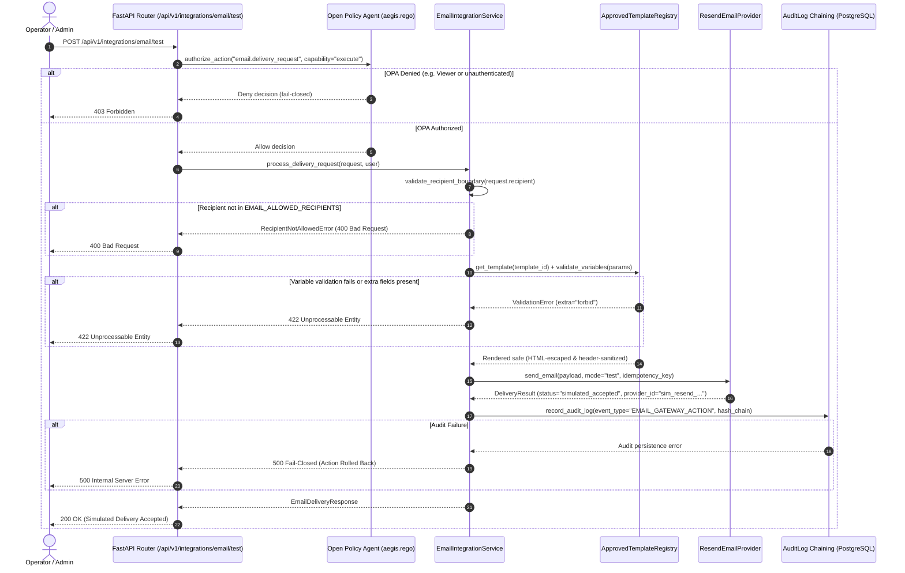

# AegisMesh 2.0 / Kavach AI — External Integration Architecture & Email Gateway Specification (Step 10.1)

## 1. Executive Summary & Security Boundary Model

AegisMesh 2.0 (Kavach AI) is evolving from a purely synthetic adversarial sandbox platform into a hybrid cybersecurity intelligence and operations system. As the platform transitions to interacting with real-world infrastructure, external service boundaries must be rigorously governed under **fail-closed**, **least-privilege**, and **cryptographically verifiable** architectural controls.

**Step 10.1** establishes the secure foundational external integration architecture, using **transactional email via Resend** as the reference implementation. Crucially, Step 10.1 introduces a strict **simulation boundary**:
- In this phase, external email delivery is **mocked/simulated**. No unconstrained outbound network requests are dispatched to external email providers.
- When `EMAIL_MODE=test`, delivery requests are validated, compiled, gated by Open Policy Agent (OPA), checked against an immutable recipient allowlist (`EMAIL_ALLOWED_RECIPIENTS`), and cryptographically committed to the tamper-evident SHA-256 chained PostgreSQL audit trail.
- Production external delivery is strictly locked down and disabled.
- Direct agent access (by either Red Team or Blue Guardian agents) to external credentials or raw email APIs is strictly prohibited. Future agent-initiated transactional notifications will require the existing human-in-the-loop Four-Eyes approval workflow.

---

## 2. Component Hierarchy and Architectural Layering

The integration framework is isolated within `backend/app/integrations/`:

```
backend/app/
├── core/
│   ├── config.py                 # Environment-backed Pydantic Settings
│   └── permissions.py            # RBAC extraction & authentication dependencies
├── integrations/
│   ├── __init__.py               # Top-level integration exports
│   ├── base.py                   # Base provider contracts (BaseEmailProvider, ProviderStatus, DeliveryResult)
│   ├── registry.py               # Provider registry & lifecycle manager
│   └── email/
│       ├── __init__.py           # Email module exports
│       ├── schemas.py            # Strict Pydantic models (ConfigDict(extra="forbid"))
│       ├── templates.py          # Approved template catalog & safe HTML escaping
│       ├── service.py            # EmailIntegrationService coordinator & allowlist gating
│       └── providers/
│           ├── __init__.py
│           └── resend.py         # Resend REST API v1 adapter contract & simulation interceptor
├── api/
│   └── integrations_email.py     # Versioned FastAPI endpoints (/api/v1/integrations/email/*)
├── policies/
│   └── aegis.rego                # OPA default-deny rules (email.delivery_request, email.template_list)
└── services/
    └── audit_service.py          # Tamper-evident SHA-256 chained audit logger
```

### Component Interaction Flow



---

## 3. Provider Abstraction & Resend Adapter Contract

### 3.1. Provider Contract (`BaseEmailProvider`)
Defined in [`app/integrations/base.py`](file:///c:/Users/Atharva/OneDrive/Desktop/AEGISMesh/backend/app/integrations/base.py):
- `provider_name`: Canonical string identifier.
- `check_health() -> ProviderStatus`: Evaluates configuration and reachability without leaking secrets.
- `send_email(...) -> DeliveryResult`: Executes transactional delivery or boundary simulation.

### 3.2. Resend REST API v1 Adapter (`ResendEmailProvider`)
Defined in [`app/integrations/email/providers/resend.py`](file:///c:/Users/Atharva/OneDrive/Desktop/AEGISMesh/backend/app/integrations/email/providers/resend.py):
- **Target Endpoint**: `POST https://api.resend.com/emails` (official documentation reference: https://resend.com/docs).
- **Authentication**: `Authorization: Bearer <RESEND_API_KEY>`. Never logged, stored in plain text, or exposed in exceptions.
- **Idempotency**: Generates or forwards UUIDv4 `Idempotency-Key` headers to guarantee zero duplicate sends on retries.
- **Timeouts**: Bounded `httpx.Timeout(connect=3.0, read=5.0, write=3.0, pool=5.0)`.
- **Step 10.1 Test Boundary**: When `EMAIL_MODE=test`, outbound HTTP calls are intercepted. The adapter validates full payload structure, generates simulated message identifiers (`sim_resend_<hex16>`), and returns `status="simulated_accepted"`.
- **Production Lock**: Any invocation in production mode raises `RuntimeError("Production external email delivery is strictly disabled in Step 10.1")`.

---

## 4. Secret Management & Credential Protection

1. **Zero Hardcoded Secrets**: Secrets are loaded strictly via environment variables in [`app/core/config.py`](file:///c:/Users/Atharva/OneDrive/Desktop/AEGISMesh/backend/app/core/config.py).
2. **Safe Placeholder Fallbacks**: For automated testing, `RESEND_API_KEY` defaults to `re_test_mode_simulation_key` in non-production environments. In production, strict validation requires a non-empty, non-placeholder API key.
3. **No Credential Leakage**:
   - `ResendEmailProvider.__repr__` and `__str__` only display boolean `configured=True/False`.
   - `_redact_secrets()` sanitizes regex patterns matching `re_[A-Za-z0-9_]+` and `Bearer [tokens]`.
   - `sanitize_event_data()` in `audit_service.py` strips keys including `api_key`, `token`, `secret`, `authorization`, and `credentials`.
   - Gateway status endpoint `GET /api/v1/integrations/email/status` returns only sanitized metadata (`is_configured: bool`), never the raw key.
4. **Environment Template**: `.env.example` has been updated with safe placeholder configurations:
   ```ini
   EMAIL_PROVIDER=resend
   EMAIL_MODE=test
   RESEND_API_KEY=re_placeholder_key_do_not_hardcode
   EMAIL_FROM_ADDRESS=security@aegismesh.local
   EMAIL_ALLOWED_RECIPIENTS=secops@aegismesh.local,operator@aegismesh.local,admin@aegismesh.local,test@aegismesh.local
   ```

---

## 5. Template Registry & Injection Prevention

Clients cannot supply arbitrary HTML, custom sender identities, arbitrary email headers, or arbitrary attachments. All transactional emails must select an approved template and provide variables strictly matching that template's Pydantic schema.

### 5.1. Approved Template Catalog
Defined in [`app/integrations/email/templates.py`](file:///c:/Users/Atharva/OneDrive/Desktop/AEGISMesh/backend/app/integrations/email/templates.py):

| Template ID | Target Purpose | Parameter Model | Required Fields |
| :--- | :--- | :--- | :--- |
| `security_alert` | Immediate notification of detected threats, attacks, or security policy violations. | `SecurityAlertParams` | `severity` ("low"\|"medium"\|"high"\|"critical"), `alert_title`, `summary` |
| `incident_notification` | Formal briefing for confirmed security incidents. | `IncidentNotificationParams` | `incident_id`, `severity`, `title`, `description` |
| `test_delivery` | Verification probe to confirm gateway connectivity and allowlisting. | `TestDeliveryParams` | `test_id`, `message`, `initiated_by` |

### 5.2. Injection Prevention Mechanics
1. **HTML & Script Injection (XSS)**:
   Every parameter interpolated into HTML templates passes through `html.escape()` with quote escaping enabled. Special characters (`<`, `>`, `&`, `"`, `'`) are converted to HTML entities (`&lt;`, `&gt;`, `&amp;`, `&quot;`, `&#x27;`), neutralizing script injection.
2. **Header Injection (CRLF)**:
   Subject lines and header values pass through `_sanitize_header_value()`, stripping all `\r` and `\n` characters to eliminate SMTP header splitting or BCC injection.
3. **Extra Field Rejection**:
   All template models and request envelopes specify `ConfigDict(extra="forbid")`. Passing unexpected client fields triggers an immediate `422 Unprocessable Entity` validation error.

---

## 6. Test-Mode Recipient Allowlisting Boundary

Under `EMAIL_MODE=test`:
- The service normalizes recipient addresses to lowercase.
- Only recipients present in `settings.EMAIL_ALLOWED_RECIPIENTS` (e.g. `secops@aegismesh.local`, `operator@aegismesh.local`, `admin@aegismesh.local`) are permitted.
- Any delivery attempt targeting an unauthorized external address is rejected with `RecipientNotAllowedError (HTTP 400 Bad Request)`.
- No silent fallback to external delivery is permitted.
- The sender address is immutable and drawn exclusively from trusted server configuration (`EMAIL_FROM_ADDRESS`).

---

## 7. Authorization & OPA Policy Rules

Authorization is governed deterministically through Open Policy Agent (OPA) in [`backend/policies/aegis.rego`](file:///c:/Users/Atharva/OneDrive/Desktop/AEGISMesh/backend/policies/aegis.rego).

### 7.1. Defined Actions
- `email.delivery_request`: Requesting execution of an email delivery probe.
- `email.template_list`: Reading catalog of approved email templates.
- `email.delivery_read`: Reading operational status and delivery telemetry.

### 7.2. Policy RBAC Matrix

| Role | `email.delivery_request` | `email.template_list` | `email.delivery_read` | Justification |
| :--- | :---: | :---: | :---: | :--- |
| **Admin** | **ALLOW** | **ALLOW** | **ALLOW** | Full administrative and security operations authority. |
| **Security Operator** | **ALLOW** | **ALLOW** | **ALLOW** | Authorized to execute security probes and operational notifications. |
| **Security Analyst** | DENY | **ALLOW** | **ALLOW** | Read-only investigation access; cannot initiate external communications. |
| **Viewer** | **DENY** | **ALLOW** | **ALLOW** | Read-only inspection; strictly prohibited from external side-effects. |
| **Unauthenticated** | **DENY** | **DENY** | **DENY** | Default-deny fails closed for all unverified actors. |

### 7.3. OPA Deny Reason Assertions
- When a `viewer` attempts delivery: `"Viewer role is not authorized for email delivery."` / `"Viewer role is restricted to read-only operations."`
- When unauthorized role attempts delivery: `"Security Operator or Admin role required for email delivery."`
- When OPA daemon is unreachable: Fail-closed (`AuthorizationDecision(allowed=False, decision="deny", reason="Authorization service unavailable (fail-closed)")`).

---

## 8. Persistent Action Tracking & SHA-256 Chained Audit Logging

Persistent action tracking reuses the existing, tamper-evident cryptographic audit log model ([`app/models/audit_log.py`](file:///c:/Users/Atharva/OneDrive/Desktop/AEGISMesh/backend/app/models/audit_log.py)):
- Every email delivery request records an `EMAIL_GATEWAY_ACTION` event.
- **Audit Payload**:
  - `delivery_id`: UUIDv4 tracking identifier.
  - `provider`: "resend".
  - `mode`: "test".
  - `status`: "simulated_accepted".
  - `template_id`: Approved template identifier.
  - `recipient`: Normalized allowlisted recipient address.
  - `from_address`: Configured sender identity.
  - `correlation_id`: Client tracing identifier.
  - `provider_message_id`: Provider reference ID.
  - `actor_username`: Authenticated actor.
- **SHA-256 Hash Chain**: Each audit entry incorporates the SHA-256 hash of the previous record, sequence number, and HMAC signature, guaranteeing non-repudiation.
- **Fail-Closed Persistence**: If database persistence fails during audit recording, the email service catches the exception, aborts the transaction, and raises `HTTP 500 Internal Server Error (fail-closed)`.

---

## 9. FastAPI REST Endpoints Specification

Prefix: `/api/v1/integrations/email` (Mounted in [`app/api/__init__.py`](file:///c:/Users/Atharva/OneDrive/Desktop/AEGISMesh/backend/app/api/__init__.py)):

### 9.1. `GET /api/v1/integrations/email/templates`
- **Summary**: List Approved Email Templates.
- **Auth**: Authenticated token (Admin, Security Operator, Security Analyst, Viewer).
- **OPA Action**: `email.template_list` (capability="read").
- **Response**: Array of `EmailTemplateInfo` objects with JSON schema properties for parameters.

### 9.2. `GET /api/v1/integrations/email/status`
- **Summary**: Email Gateway Health & Configuration Status.
- **Auth**: Authenticated token.
- **OPA Action**: `email.delivery_read` (capability="read").
- **Response**: `EmailStatusResponse` containing provider name, mode ("test"), configured status, allowlisted recipient count, and template catalog list. Credentials are never exposed.

### 9.3. `POST /api/v1/integrations/email/test`
- **Summary**: Test Email Delivery Probe.
- **Auth**: Authenticated token (Admin, Security Operator only. Viewer receives 403 Forbidden).
- **OPA Action**: `email.delivery_request` (capability="execute").
- **Request Body**: `EmailDeliveryRequest` (`recipient`, `template_id`, `template_variables`, `correlation_id`).
- **Validation**:
  - Rejects unknown attributes (`extra="forbid"` -> 422).
  - Rejects unauthorized recipients outside allowlist (400 Bad Request).
  - Validates template variables against approved Pydantic models (422).
- **Response**: `EmailDeliveryResponse` with `delivery_id`, `status="simulated_accepted"`, `mode="test"`, and simulated provider metadata.

---

## 10. Operational Verification Matrix & Next Steps (Step 10.2)

### 10.1. Automated Test Suite Results
Automated test suite [`backend/tests/test_email_integration.py`](file:///c:/Users/Atharva/OneDrive/Desktop/AEGISMesh/backend/tests/test_email_integration.py) executes 15 dedicated verification tests covering all security boundaries:

```
collected 15 items
backend/tests/test_email_integration.py ............... [100%]
============================== 15 passed in 8.01s ==============================
```

Combined suite verification (`test_email_integration.py` + `test_agent_arena.py` + `test_multi_vector_red_team.py` + `test_security_gateway.py`):
```
collected 46 items
backend/tests/test_email_integration.py ...............                  [ 32%]
backend/tests/test_agent_arena.py .......                                [ 47%]
backend/tests/test_multi_vector_red_team.py .........                    [ 67%]
backend/tests/test_security_gateway.py ...............                   [100%]
============================== 46 passed in 11.90s =============================
```

### 10.2. Preparation for Step 10.2 (Authorized External Delivery)
When transitioning to Step 10.2:
1. **Outbound HTTPS Client**: Introduce live `httpx.AsyncClient` transport in `ResendEmailProvider` when `EMAIL_MODE=production`.
2. **Approval Model Integration**: Require Four-Eyes human authorization for any agent-initiated email notification.
3. **Delivery Webhook Ingestion**: Implement signed Resend webhook receivers with Svix cryptographic signature verification for tracking `delivered`, `bounced`, and `complained` events.
4. **Rate Limiting & Throttling**: Add Redis-backed token bucket rate limiters to prevent provider API exhaustion.
