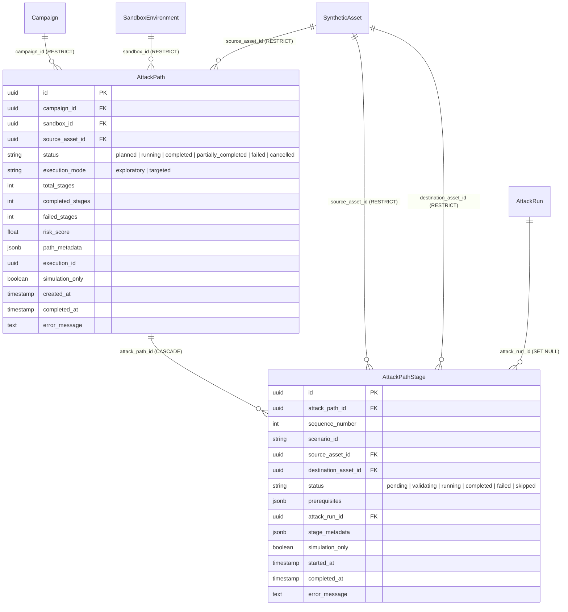

# AegisMesh 2.0 — Red Team Agent and Deterministic Simulation Engine Architecture

## 1. Overview and Architectural Intent

The Red Team Subsystem provides an extensible, fully synthetic, and deterministic security assessment framework within AegisMesh 2.0. It acts as the adversarial simulation engine designed to systematically probe synthetic target assets (`SyntheticAsset`) registered inside isolated sandboxes (`SandboxEnvironment`) under designated campaigns (`Campaign`).

### Core Objectives
1. **Deterministic Assessment**: Provide repeatable, predictable security simulation scenarios driven entirely by synthetic asset configurations and profiles.
2. **Absolute Execution Safety (100% Synthetic)**: Zero network sockets, zero subprocess execution, zero external network traffic, and zero shell commands. All IP references are strictly non-routable documentation ranges conforming to **RFC 5737** (`192.0.2.0/24`, `198.51.100.0/24`, `203.0.113.0/24`).
3. **Complete Auditable Lifecycle & State Machine**: Every attack simulation is bound to an `AttackRun` record tracking explicit states (`pending` → `running` → `completed` or `failed`), with complete 5-stage persistent SHA-256 chained audit logs.
4. **Database-Level Concurrency Safety**: Prevents race conditions and duplicate scenario runs within the same campaign using PostgreSQL transaction-level advisory locks (`pg_try_advisory_xact_lock`) and row-level locking (`with_for_update`).
5. **Strict Authorization & Isolation**: Simulations are strictly confined to `environment == "sandbox"` and authorized roles (`admin`, `security_operator`). `viewer` and `security_analyst` roles are strictly denied from executing simulations.
6. **Future Guardian Interoperability**: Simulation outputs emit structured discrete events (`SimulationEvent`) and findings (`SimulationFinding`) structured for ingestion by the upcoming Blue Guardian detection and correlation subsystem (Step 09.2).

---

## 2. Component Architecture

```
                                  +---------------------------------------+
                                  |            FastAPI API                |
                                  |   /api/v1/red-team/campaigns/...      |
                                  +-------------------+-------------------+
                                                      |
                                                      v
                                  +---------------------------------------+
                                  |           Security Gateway            |
                                  |    (OPA Rego Default-Deny Policy)     |
                                  +-------------------+-------------------+
                                                      |
                                                      v
+----------------------------------------------------------------------------------------------------+
|                                         RedTeamAgent                                               |
|  - Complete 5-stage audit logging (requested -> authorized -> started -> completed / failed)       |
|  - PostgreSQL advisory lock: pg_try_advisory_xact_lock(hashtext(c), hashtext(s))                   |
|  - Campaign & Sandbox association check                                                            |
|  - Asset membership & compatibility validation                                                     |
|  - AttackRun lifecycle state machine (pending -> running -> completed / failed)                    |
|  - Fail-closed audit policy & persistent forensic retention on failure                             |
+-------------------------------------------------+--------------------------------------------------+
                                                  |
                                                  v
+----------------------------------------------------------------------------------------------------+
|                                    SimulationEngine & Registry                                     |
|  - Scenario Registry with strict type validation (Pydantic extra="forbid")                         |
|  - 8 Deterministic Scenario Handlers (3 foundational + 5 advanced):                               |
|      * simulated_service_discovery: T1046 (Synthetic Simulation)                                   |
|      * simulated_weak_configuration_assessment: Conceptual Assessment (N/A)                        |
|      * simulated_authentication_anomaly: T1110 (Synthetic Simulation)                              |
|      * simulated_initial_access: T1190 (Synthetic Simulation)                                      |
|      * simulated_privilege_escalation: T1068 (Synthetic Simulation)                                 |
|      * simulated_lateral_movement: T1021 (Synthetic Simulation, connected_asset_ids)              |
|      * simulated_persistence: T1053 (Synthetic Simulation)                                         |
|      * simulated_data_exfiltration: T1048 (Synthetic Simulation)                                   |
|  - Evaluates SyntheticAsset metadata, configuration, connected_asset_ids, simulated_vulns          |
|  - Produces structured SimulationEvidence objects and enriched event streams                       |
+-------------------------------------------------+--------------------------------------------------+
                                                  |
                                                  v
+----------------------------------------------------------------------------------------------------+
|                                    PostgreSQL / Persistence                                        |
|  - campaigns (configuration.sandbox_id)                                                            |
|  - attack_runs (technique, scenario, outcome, risk_score, execution_metadata)                      |
|  - audit_logs (tamper-evident sequential SHA-256 hash chaining, advisory locks)                    |
+----------------------------------------------------------------------------------------------------+
```

---

## 3. Comprehensive Synthetic Scenario Library (Step 09.2.1)

The scenario registry maintains eight deterministic scenarios (three foundational + five advanced) with explicit distinction between actual ATT&CK emulation and conceptual assessment:

### 3.1. `simulated_service_discovery`
- **Category**: `discovery`
- **Technique**: MITRE ATT&CK `T1046 - Network Service Discovery (Synthetic Simulation)`
- **Technique ID**: `T1046`
- **Mapping Type**: `technique_emulation` (Synthetic)
- **Applicable Asset Types**: `server`, `web_application`, `api`, `network_device`
- **Description & Mechanism**: Generates synthetic service enumeration events and discovers simulated open network ports on synthetic targets from asset metadata. Corresponds conceptually to MITRE ATT&CK T1046 (Network Service Discovery) without performing real network probing or socket operations.
- **Outputs**:
  - Events: `simulation_started`, `service_enumerated` for each discovered listener, `simulation_completed`.
  - Findings: Flags insecure or legacy unencrypted protocols (FTP, Telnet) with elevated risk; enumerates attack surface.
  - Calculated risk score: 2.0 to 10.0 based on port count and protocol sensitivity.

### 3.2. `simulated_weak_configuration_assessment`
- **Category**: `configuration`
- **Technique**: `Synthetic Configuration Audit (Conceptual)`
- **Technique ID**: `N/A (Conceptual Assessment)`
- **Mapping Type**: `conceptual_scenario`
- **Applicable Asset Types**: `server`, `database`, `web_application`, `api`, `network_device`
- **Description & Mechanism**: Performs deterministic evaluation of synthetic asset configurations and simulated vulnerabilities for security misconfigurations (such as debug mode, deprecated TLS, or insecure defaults).
  *Note on MITRE ATT&CK Mapping*: The official MITRE ATT&CK Enterprise knowledge base does not define a standalone offensive technique for passive configuration assessment. This scenario represents a conceptual security posture audit rather than adversary technique emulation.
- **Outputs**:
  - Events: `simulation_started`, `misconfiguration_detected`, `vulnerability_identified`, `simulation_completed`.
  - Findings: Actionable security findings specifying severity, CWE/CVE mappings, and remediation recommendations.
  - Calculated risk score: Weighted aggregation of detected misconfigurations and CVE risk weights.

### 3.3. `simulated_authentication_anomaly`
- **Category**: `credential_access`
- **Technique**: MITRE ATT&CK `T1110 - Brute Force (Synthetic Simulation)`
- **Technique ID**: `T1110` (Sub-technique: `T1110.001 - Password Guessing`)
- **Mapping Type**: `technique_emulation` (Synthetic)
- **Applicable Asset Types**: `server`, `database`, `web_application`, `api`
- **Description & Mechanism**: Simulates synthetic high-frequency authentication attempts and anomaly patterns against synthetic targets without initiating actual network traffic. Corresponds conceptually to MITRE ATT&CK T1110 (Brute Force).
- **Outputs**:
  - Events: `synthetic_auth_stream_generated`, `threshold_exceeded`, `anomaly_compromise_simulated` (if vulnerable), `simulation_completed`.
  - Findings: Brute-force threshold breaches, credential compromise indicators, and IP throttling recommendations.
  - Calculated risk score: 6.5 to 8.5 depending on whether credential hit occurred.

### 3.4. `simulated_initial_access` (Advanced)
- **Category**: `initial_access`
- **Technique**: MITRE ATT&CK `T1190 - Exploit Public-Facing Application (Synthetic Simulation)`
- **Technique ID**: `T1190`
- **Mapping Type**: `technique_emulation` (Synthetic)
- **Applicable Asset Types**: `server`, `web_application`, `api`, `network_device`
- **Description & Mechanism**: Evaluates synthetic entry-point viability on public-facing synthetic targets. Checks preconditions including exposed services, weak API endpoints (`auth_required: False`), or simulated high/critical vulnerabilities. Never initiates actual network sessions, exploits, or shell access.
- **Invariants**: Declares `actual_compromise: False`, `simulation_only: True`, `is_simulated: True`.
- **Outputs**:
  - Events: `simulation_started`, `simulated_access_attempt`, `simulated_access_succeeded` / `simulated_access_blocked`, `simulation_completed`.
  - Findings: Initial access vectors flagged with structured `SimulationEvidence` (`synthetic_entry_point` or `hardened_entry_point`).
  - Calculated risk score: 8.0 (when preconditions satisfied) vs. 2.0 (when blocked/hardened).

### 3.5. `simulated_privilege_escalation` (Advanced)
- **Category**: `privilege_escalation`
- **Technique**: MITRE ATT&CK `T1068 - Exploitation for Privilege Escalation (Synthetic Simulation)`
- **Technique ID**: `T1068`
- **Mapping Type**: `technique_emulation` (Synthetic)
- **Applicable Asset Types**: `server`, `workstation`, `database`
- **Description & Mechanism**: Evaluates synthetic privilege boundaries against fictional excessive permissions (`mock_permissions` containing `sudo_nopasswd`, `root_access`, `wheel`), administrative roles, or mock local privilege escalation vulnerabilities. Never modifies host OS permissions, processes, or tokens.
- **Invariants**: Declares `actual_privilege_change: False`, `simulation_only: True`, `is_simulated: True`.
- **Outputs**:
  - Events: `simulation_started`, `privilege_check_simulated`, `simulated_privilege_transition` / `simulated_privilege_denied`, `simulation_completed`.
  - Findings: Privilege escalation pathways flagged with `SimulationEvidence` (`excessive_permissions_grant` or `least_privilege_enforced`).
  - Calculated risk score: 8.5 (when escalation viable) vs. 2.0 (least privilege enforced).

### 3.6. `simulated_lateral_movement` (Advanced)
- **Category**: `lateral_movement`
- **Technique**: MITRE ATT&CK `T1021 - Remote Services (Synthetic Simulation)`
- **Technique ID**: `T1021`
- **Mapping Type**: `technique_emulation` (Synthetic)
- **Applicable Asset Types**: `server`, `workstation`, `database`
- **Description & Mechanism**: Evaluates synthetic lateral movement paths between assets registered within the same sandbox environment based on explicit `connected_asset_ids` relationships. Validates target presence, sandbox isolation boundaries, and non-archived status. Never creates actual network connections, probes, or hops.
- **Boundary Controls**:
  - Missing `destination_asset_id` parameter -> `missing_destination_asset_parameter`.
  - Destination asset non-existent -> `destination_asset_not_found`.
  - Destination asset in different sandbox -> `cross_sandbox_destination_rejected` (Strict isolation enforcement).
  - Destination asset archived -> `archived_destination_rejected`.
  - Destination asset not in source's `connected_asset_ids` -> `unrelated_target_rejected`.
- **Invariants**: Declares `actual_network_movement: False`, `simulation_only: True`, `is_simulated: True`.
- **Outputs**:
  - Events: `simulation_started`, `relationship_validation_simulated`, `simulated_lateral_transition` / `simulated_movement_blocked`, `simulation_completed`.
  - Findings: Structured `SimulationEvidence` (`connected_asset_relationship`, `segmentation_enforced`, or `sandbox_isolation_boundary`).
  - Calculated risk score: 7.5 (when connected relationship exists) vs. 2.0 (unrelated target / blocked).

### 3.7. `simulated_persistence` (Advanced)
- **Category**: `persistence`
- **Technique**: MITRE ATT&CK `T1053 - Scheduled Task/Job (Synthetic Simulation)`
- **Technique ID**: `T1053`
- **Mapping Type**: `technique_emulation` (Synthetic)
- **Applicable Asset Types**: `server`, `workstation`, `network_device`
- **Description & Mechanism**: Inspects synthetic asset configurations for mock persistence mechanisms (e.g., fictional `scheduled_tasks`, `cron_jobs`, or `startup_services`). Never writes actual crontabs, scheduled jobs, daemon files, or registry keys.
- **Invariants**: Declares `actual_persistence_established: False`, `simulation_only: True`, `is_simulated: True`.
- **Outputs**:
  - Events: `simulation_started`, `persistence_scan_simulated`, `simulated_persistence_indicator_flagged`, `simulation_completed`.
  - Findings: Structured `SimulationEvidence` (`synthetic_persistence_indicator` or `clean_persistence_profile`).
  - Calculated risk score: 7.5 (when indicator found) vs. 1.5 (clean profile).

### 3.8. `simulated_data_exfiltration` (Advanced)
- **Category**: `exfiltration`
- **Technique**: MITRE ATT&CK `T1048 - Exfiltration Over Alternative Protocol (Synthetic Simulation)`
- **Technique ID**: `T1048`
- **Mapping Type**: `technique_emulation` (Synthetic)
- **Applicable Asset Types**: `server`, `database`, `api`
- **Description & Mechanism**: Simulates staging and transfer of fictional sensitive datasets (`restricted`, `confidential`, `pii`). Generates descriptive volume metrics without reading actual bytes, transmitting network payloads, or opening outbound sockets.
- **Invariants**: Declares `actual_data_transferred: False`, `actual_bytes_transferred: 0`, `simulation_only: True`, `is_simulated: True`.
- **Outputs**:
  - Events: `simulation_started`, `simulated_data_access_query`, `simulated_exfiltration_stream` / `simulated_exfiltration_blocked`, `simulation_completed`.
  - Findings: Structured `SimulationEvidence` (`synthetic_data_movement` or `data_access_restricted`).
  - Calculated risk score: 9.0 (sensitive data exfiltration simulated) vs. 2.0 (access blocked).

---

## 4. Synthetic Evidence Model (`SimulationEvidence`)

Every finding generated by the simulation engine carries a strongly-typed `SimulationEvidence` record (`extra="forbid"`):

```json
{
  "evidence_id": "44b71d59-2ffa-477a-be96-1585e9414703",
  "scenario_id": "simulated_initial_access",
  "evidence_type": "synthetic_entry_point",
  "synthetic_asset_references": ["3d95dc16-0c91-4652-a0c5-d8ee3a398071"],
  "finding_description": "Synthetic asset configuration satisfies initial access entry criteria",
  "severity": "high",
  "confidence": "high",
  "supporting_synthetic_metadata": {
    "precondition_satisfied": true,
    "vector": "public_facing_exploit"
  },
  "is_simulated": true,
  "simulation_only": true
}
```

### Evidence Characteristics:
- **Traceability**: Links directly to the asset UUIDs involved (`synthetic_asset_references`).
- **Proof of Rule Evaluation**: `supporting_synthetic_metadata` stores the exact deterministic configuration attributes that caused the finding.
- **Confidence Rating**: Indicates high/medium/low synthetic confidence in the rule evaluation.
- **Safety Invariants**: Contains explicit flags `is_simulated: true` and `simulation_only: true`.

---

## 5. Blue Guardian Detection Handoff Contract (Step 09.2)

All events emitted during Red Team simulation runs are structured specifically for real-time ingestion, event correlation, and detection rule evaluation by the upcoming Blue Guardian subsystem:

### Enriched Event Header
```json
{
  "event_id": "550e8400-e29b-41d4-a716-446655440000",
  "timestamp": "2026-10-31T23:55:00Z",
  "event_type": "simulated_lateral_transition",
  "scenario_id": "simulated_lateral_movement",
  "campaign_id": "c1a2b3c4-...",
  "attack_run_id": "a9b8c7d6-...",
  "sandbox_id": "s1s2s3s4-...",
  "source_asset_id": "src-uuid",
  "destination_asset_id": "dst-uuid",
  "severity": "high",
  "message": "Simulated lateral movement path validated: web-server -> db-server",
  "details": {
    "actual_network_movement": false,
    "relationship_type": "connected_asset"
  },
  "event_metadata": {
    "source": "src-uuid",
    "destination": "dst-uuid",
    "actual_network_movement": false
  },
  "is_simulated": true,
  "simulation_only": true
}
```

### Correlation Guarantees for Blue Guardian:
1. **Correlation Key Tuple**: Every event carries `(campaign_id, attack_run_id, sandbox_id, scenario_id)` enabling unambiguous multi-hop attack graph reconstruction.
2. **Explicit Hop Topology**: Multi-asset scenarios (`simulated_lateral_movement`) populate both `source_asset_id` and `destination_asset_id`, providing explicit graph edges for detection correlation.
3. **Synthetic Ground Truth**: Non-compromise indicators (`actual_compromise: false`, `actual_privilege_change: false`, `actual_network_movement: false`, `actual_persistence_established: false`, `actual_data_transferred: false`) guarantee that Blue Guardian operates on pure telemetry indicators without security risk.

---

## 6. Complete Execution Audit Lifecycle & State Machine

Each simulation execution operates as an atomic state transition on the `AttackRun` database entity, with full 5-stage persistent audit logging:

```
[ Client Request ]
       │
       ▼
[ Stage 1: red_team.simulation_requested ] ──► Persist audit log (fail-closed)
       │
       ▼
[ Security Gateway / OPA Evaluation ]
       │
       ▼
[ Stage 2: red_team.authorization_passed ] ──► Persist audit log (fail-closed)
       │
       ▼
[ Boundary Validation & DB Advisory Lock ]
       │
       ▼
[ Stage 3: red_team.simulation_started ] ──► AttackRun created ('running'), audit log persisted
       │
       ├─────────────────────────────────────────┐
       ▼                                         ▼
 (Execution Success)                       (Execution Error)
       │                                         │
[ Stage 4: red_team.simulation_completed ] [ Stage 5: red_team.simulation_failed ]
  - AttackRun outcome = 'completed'          - AttackRun outcome = 'failed'
  - risk_score & execution_metadata          - Error details in execution_metadata
  - Persist audit & COMMIT                   - Persist audit & COMMIT (forensic evidence retained)
```

### Audit Event Types and Metadata
1. `red_team.simulation_requested`: Actor, Campaign ID, Scenario ID, Target Asset ID, `simulation_only: True`.
2. `red_team.authorization_passed`: Actor, Decision Reason, Policy Version, `simulation_only: True`.
3. `red_team.simulation_started`: Actor, Run ID, Campaign ID, Scenario ID, Technique, Target Asset ID, `simulation_only: True`.
4. `red_team.simulation_completed`: Actor, Run ID, Campaign ID, Scenario ID, Risk Score, Findings Count, `simulation_only: True`.
5. `red_team.simulation_failed`: Actor, Run ID, Campaign ID, Scenario ID, Technique, Error details, `simulation_only: True`.

---

## 7. Database-Level Concurrency Safety

### Guarantee Enforced
Within any given `Campaign`, exactly **one active execution run** may proceed per `scenario_id` at any moment in time. Simultaneous requests for the same scenario under the same campaign cannot both succeed.

### Technical Mechanism
1. **PostgreSQL Transaction-Level Advisory Lock**:
   `SELECT pg_try_advisory_xact_lock(hashtext(:campaign_id), hashtext(:scenario_id));`
   - Atomically attempts to acquire a transaction-scoped lock for the specific `(campaign_id, scenario_id)` tuple.
   - If another concurrent transaction is already creating/running the scenario, `pg_try_advisory_xact_lock` immediately returns `False`.
   - The engine translates this into an immediate HTTP 409 Conflict without deadlocks or connection hangs.
2. **PostgreSQL Row-Level Locking on Existing Runs**:
   When referencing an existing `run_id`, `SELECT ... FROM attack_runs WHERE id = :run_id FOR UPDATE` serializes state checks, ensuring a completed or actively running run cannot be re-executed.
3. **Preservation of Independent Concurrent Operations**:
   - Different campaigns acquire distinct advisory lock hash pairs and execute in parallel without contention.
   - Different scenarios within the same campaign acquire distinct lock hash pairs and execute in parallel.
   - Locks are transaction-scoped (`_xact_lock`), automatically releasing when the transaction commits or aborts without requiring manual unlock steps.

---

## 8. Cryptographic Audit Trail Mechanism

### Exact Cryptographic Mechanism
The AegisMesh audit logging subsystem uses a **sequential SHA-256 cryptographic hash chain**:
- **Genesis Block**: Initiated with a 64-character zero string (`0` * 64).
- **Canonical Payload**: Deterministically constructed JSON containing event UUID, event type, actor ID/role, action, resource type/ID, decision, sanitized event data, and UTC timestamp.
- **Hash Chaining**: `event_hash = sha256(previous_hash + canonical_payload)`.

> [!NOTE]
> The audit chain is an **unkeyed sequential SHA-256 hash chain**, NOT HMAC-SHA-256. Python's `hmac.compare_digest` function is used exclusively for constant-time string comparison to defend against timing attacks during hash verification, not for keyed hashing.

### Fail-Closed & Forensic Retention Policies
- **Fail-Closed on Write Error**: If PostgreSQL cannot write an audit log entry (advisory lock failure, database error), the current transaction rolls back immediately and raises HTTP 500.
- **Forensic Retention on Execution Failure**: If simulation logic encounters an error, the `AttackRun` failure status (`outcome="failed"`) and the `red_team.simulation_failed` audit event are explicitly committed to the database, ensuring operational failures leave a complete forensic record.

---

## 9. Security Boundaries & Authorization Model

Security enforcement is governed by Open Policy Agent (`backend/policies/aegis.rego`) and enforced via `authorize_action`:

| Operation | Capability | Required Roles | Allowed Environments | Description |
| :--- | :--- | :--- | :--- | :--- |
| `redteam.simulate` | `scan` / `execute` | `admin`, `security_operator` | `sandbox` ONLY | Triggers simulation run |
| `redteam.run_read` | `read` | `admin`, `security_operator`, `security_analyst` | All | Reads simulation results |
| `redteam.scenario_list` | `read` | `admin`, `security_operator`, `security_analyst` | All | Lists registered scenarios |
| Any execution by `viewer` | Any | None | Denied | Viewers cannot run simulations |
| Non-sandbox execution | Any | None | Denied | Even admins cannot simulate outside sandbox |

---

## 10. Invariant and Safety Enforcement (100% Synthetic Guarantee)

1. **No External Network Communication**: Absolutely zero sockets (`socket.socket`), zero HTTP/gRPC/raw network clients, zero DNS lookups.
2. **No Subprocess or Shell Execution**: Absolute prohibition against `subprocess.Popen`, `os.system`, `asyncio.create_subprocess_exec`, or shell invocations.
3. **No Real Privilege Changes**: Operating system users, sudo privileges, and tokens are never modified; fictional transitions are evaluated strictly against metadata.
4. **No Real File Persistence**: No cron entries, systemd units, registry keys, or startup binaries are written or modified.
5. **No Production Data Access or Exfiltration**: Zero production bytes are read or moved across boundaries; all transfer volume metrics are fictional descriptive strings.
6. **Strict RFC 5737 IP Notation**: All IP addresses used as simulated sources or destinations are strictly restricted to `192.0.2.0/24`, `198.51.100.0/24`, or `203.0.113.0/24`.

---

## 11. Step 09.2.2 — Attack Path Orchestration Engine

### 11.1. Architecture Overview
The Attack Path Orchestration Engine extends AegisMesh's deterministic Red Team simulation capability from isolated, single-step scenario runs into coherent, multi-stage kill chains. It enables operators to systematically plan, validate, coordinate, and reconstruct complex adversarial trajectories across interconnected synthetic assets.

Key components:
1. **Scenario Dependency Engine (`ScenarioDependencyEngine`)**: Validates scenario transitions and prerequisites against the MITRE ATT&CK kill-chain flow (`discovery` -> `configuration` -> `credential_access` -> `initial_access` -> `privilege_escalation` -> `lateral_movement` -> `persistence` -> `exfiltration`).
2. **Asset Relationship Graph (`AssetRelationshipGraph`)**: In-memory graph constructed from `SyntheticAsset.connected_asset_ids` within the sandbox boundary. Uses BFS/DFS for reachability, neighbor discovery, and multi-hop paths without external graph dependencies.
3. **Attack Path Planner (`plan_attack_path`)**: Generates deterministic linear attack trajectories (`AttackPath` + ordered `AttackPathStage` sequence) targeting compatible synthetic assets and honoring `connected_asset_ids` for lateral movement.
4. **Attack Path Coordinator (`execute_attack_path`)**: Coordinates sequential execution of attack path stages via `RedTeamAgent.execute_run()`. Enforces fail-stop execution semantics, audit logging, and dynamic status updates (`planned` -> `running` -> `completed` / `partially_completed` / `failed` / `cancelled`).
5. **Risk Aggregation Engine (`calculate_path_risk`)**: Computes deterministic, bounded composite risk scores across all completed stages and asset risk tiers.
6. **Event Correlation & Reconstruction (`correlate_attack_path_events`, `reconstruct_attack_path_graph`)**: Maps discrete forensic simulation events across all stages into unified timeline events, nodes, and edges for visualization and Blue Guardian ingestion.

### 11.2. Data Model Diagram



### 11.3. New API Endpoints

All endpoints are registered under `/api/v1/attack-paths`:

| Method | Endpoint | Capability | Required Roles | Description |
| :--- | :--- | :--- | :--- | :--- |
| `POST` | `/api/v1/attack-paths/plan` | `scan` | `admin`, `security_operator` | Plans a multi-stage attack path from a starting asset |
| `POST` | `/api/v1/attack-paths/{id}/execute` | `scan` | `admin`, `security_operator` | Executes all pending stages of an attack path sequentially |
| `GET` | `/api/v1/attack-paths/{id}` | `read` | `admin`, `security_operator`, `security_analyst` | Retrieves attack path details and stage statuses |
| `GET` | `/api/v1/attack-paths/` | `read` | `admin`, `security_operator`, `security_analyst` | Lists attack paths filtered by campaign, sandbox, or status |
| `GET` | `/api/v1/attack-paths/{id}/stages` | `read` | `admin`, `security_operator`, `security_analyst` | Lists all stages of an attack path in sequence order |
| `GET` | `/api/v1/attack-paths/{id}/graph` | `read` | `admin`, `security_operator`, `security_analyst` | Returns node/edge graph representation for frontend visualization |
| `GET` | `/api/v1/attack-paths/{id}/report` | `read` | `admin`, `security_operator`, `security_analyst` | Generates a complete forensic report with correlated events |
| `POST` | `/api/v1/attack-paths/{id}/cancel` | `scan` | `admin`, `security_operator` | Cancels execution, skipping remaining pending stages |

### 11.4. Planning Algorithm
The planning algorithm executes deterministically:
1. **Validation**: Verifies campaign is in `sandbox` environment, target sandbox is active (non-archived), and source asset exists and is online within that sandbox.
2. **Graph Ingestion**: Loads non-archived sandbox assets into `AssetRelationshipGraph`.
3. **Seed Stage**: Identifies initial scenario compatible with the source asset (e.g. `simulated_service_discovery`).
4. **Trajectory Expansion**: Iterates up to `max_stages` (default 5, max 10):
   - Consults `ScenarioDependencyEngine.get_candidate_next_scenarios()` based on kill-chain progression.
   - For `simulated_lateral_movement`, validates connected neighbors via `AssetRelationshipGraph.get_neighbors()`. If no connected neighbors exist within the sandbox, lateral movement is rejected and the candidate list proceeds to alternate scenarios.
   - If lateral movement is selected, destination asset becomes the source asset for subsequent stages.
5. **Stage Generation**: Appends stages with 1-based `sequence_number`, empty initial prerequisites, and metadata.
6. **Path Persistence**: Writes `AttackPath` and `AttackPathStage` entities in `planned` state, returning path metadata and projected graph.

### 11.5. Risk Aggregation Formula
The composite risk score for an attack path is deterministic, monotonic, and bounded within `[0.0, 10.0]`:

$$R_{path} = \min\left(10.0, \; \left(0.5 \times \mu_{stages} + 0.3 \times \max(S_{stages}) + 0.2 \times \mu_{assets} \times 10.0\right) \times \left(\frac{N_{completed}}{N_{total}}\right)\right)$$

Where:
- $\mu_{stages}$: Arithmetic mean of completed stage risk scores (default 0.0 if empty).
- $\max(S_{stages})$: Peak risk score observed across completed stages (default 0.0 if empty).
- $\mu_{assets}$: Mean normalized risk level of involved assets (`low=0.25`, `medium=0.50`, `high=0.75`, `critical=1.00`).
- $\frac{N_{completed}}{N_{total}}$: Completion ratio factor ensuring partially executed paths reflect proportionate achieved risk.
- Bounded strictly to $[0.0, 10.0]$ with two decimal places.

### 11.6. Safety Invariants Enforced
1. **100% Synthetic Telemetry**: All stages and events carry `simulation_only: True` and `is_simulated: True`.
2. **Strict Sandbox Isolation**: Planning and execution strictly reject assets outside the campaign's bound sandbox or cross-sandbox movements.
3. **No Dynamic Inference of Lateral Movement**: Lateral movement paths require explicit presence in `connected_asset_ids`. Implicit or inferred network reachability is prohibited.
4. **Advisory Locking & Serialized Execution**: Concurrent duplicate executions of the same attack path are prevented via PostgreSQL transactional advisory locks and state machine validation.
5. **Restricted Deletion Semantics**: Foreign keys for campaigns, sandboxes, and assets use `ON DELETE RESTRICT` on forensic records, preventing accidental cascade deletion of audit histories.
