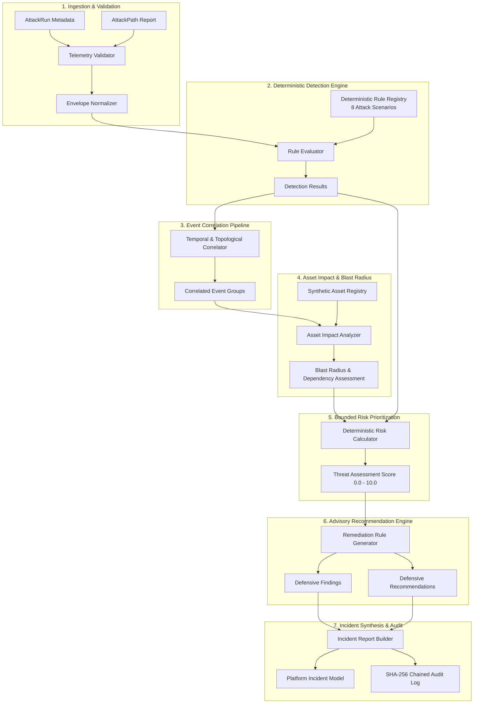

# Blue Guardian Agent — Defensive Architecture Design
## AegisMesh 2.0 Subsystem Design Specification (Step 09.2.3.1)

---

## 1. Executive Summary & Purpose

The **Blue Guardian Agent** is the defensive threat analysis, telemetry correlation, asset impact evaluation, and incident advisory engine of AegisMesh 2.0. 

While the **Red Team Agent** (Steps 09.1, 09.1.1, 09.2.1) executes deterministic, application-level synthetic attacks against target assets in isolated sandboxes, and the **Attack Path Orchestration Engine** (Step 09.2.2) constructs multi-stage kill chains, the **Blue Guardian Agent** operates as the cognitive defensive counterpart. It consumes synthetic attack telemetry, evaluates deterministic detection rules, groups disjoint telemetry into correlated incident narratives, measures asset blast radius and operational risk, and formulates prioritized, human-gated remediation recommendations.

```
+--------------------------------------------------------------------------------------------------+
|                                    AegisMesh 2.0 Platform                                        |
|                                                                                                  |
|   +-----------------------+     Execution Telemetry     +------------------------------------+   |
|   |    Red Team Agent     |---------------------------->|     Attack Run Metadata Store      |   |
|   | (Scenarios 1-8 Engine)|   (SimulationEvent/Finding) | (AttackRun.execution_metadata JSON)|   |
|   +-----------------------+                             +------------------------------------+   |
|               |                                                            |                     |
|               v                                                            v                     |
|   +-----------------------+                             +------------------------------------+   |
|   |  Attack Path Engine   |---------------------------->|        Blue Guardian Agent         |   |
|   | (Multi-Stage Chains)  |      AttackPath Report      |  - Deterministic Detection Engine  |   |
|   +-----------------------+                             |  - Event Correlation Pipeline      |   |
|                                                         |  - Asset Impact & Blast Radius     |   |
|                                                         |  - Bounded Risk Prioritization     |   |
|                                                         |  - Advisory Recommendation Engine  |   |
|                                                         +------------------------------------+   |
|                                                                            |                     |
|                                                                            v                     |
|                                                         +------------------------------------+   |
|                                                         |   Incident & Evaluation Records    |   |
|                                                         |    (incidents / approvals tables)  |   |
|                                                         |    (Forensic SHA-256 Audit Chain)  |   |
|                                                         +------------------------------------+   |
+--------------------------------------------------------------------------------------------------+
```

---

## 2. Core Architectural Principles & Invariants

1. **Strict Synthetic Telemetry Invariant**:
   Blue Guardian operates exclusively on synthetic telemetry generated within `SandboxEnvironment` boundaries. It possesses zero network sockets, shell execution interfaces, or outbound communication hooks to external infrastructure.
2. **Defensive Telemetry Immutability**:
   Blue Guardian cannot alter, redact, or overwrite `AttackRun` telemetry or `SimulationEvent` streams. Red Team outputs are treated as immutable forensic evidence.
3. **Sandbox Scoping & Tenant Isolation**:
   Every Blue Guardian execution is bounded by a single `sandbox_id`. Cross-sandbox correlation or telemetry leakage is architecturally prohibited and enforced at the database and query layer.
4. **Deterministic & Explainable Evaluation**:
   Detection rules, correlation logic, and risk formulas are 100% deterministic, eliminating nondeterministic hallucination in risk ranking and severity classification.
5. **Advisory Remediation Guardrail (Zero Autonomous Mutation)**:
   Blue Guardian produces *recommendations* and *action specifications*. It is strictly prohibited from executing automated code changes, configuration modifications, or asset terminations without explicit 4-eyes human approval recorded in the `approvals` table.

---

## 3. High-Level Modular Architecture

The Blue Guardian subsystem is structured into seven decoupled, unidirectional processing modules:



---

## 4. Subsystem Module Deep-Dive

### 4.1 Ingestion & Normalization Pipeline
- **Input Sources**:
  - `AttackRun.execution_metadata`: Contains `events: list[SimulationEvent]` and `findings: list[SimulationFinding]`.
  - `AttackPath.graph_data` / `AttackPathReportResponse`: Contains stages, transition edges, and cumulative path risk.
- **Normalization**:
  - Unwraps raw JSON into typed `DefensiveEventEnvelope` instances.
  - Verifies forensic integrity: checks that `is_simulated == True`, `simulation_only == True`, and validates the SHA-256 payload digest.
  - Deduplicates events using `source_event_id` and timestamps.

### 4.2 Deterministic Detection Engine
The detection engine matches normalized telemetry against a comprehensive registry of deterministic detection rules aligned with the 8 Red Team attack scenarios:

| Rule ID | Targeted Scenario | MITRE Technique | Detection Predicate & Criteria |
|---|---|---|---|
| `DET-AUTH-001` | `scenario_api_auth_bypass` | T1078, T1552 | Ingestion of `SimulationEvent` with `event_type="auth_bypass"` or missing JWT claims with HTTP 200 response on privileged endpoints. |
| `DET-PRIV-002` | `scenario_privilege_escalation` | T1068, T1548 | Telemetry exhibiting role escalation from `analyst`/`viewer` to `admin` without corresponding human approval token. |
| `DET-EXFIL-003` | `scenario_data_exfiltration` | T1041, T1567 | High-volume simulated data egress events or synthetic PII/database dump payload signatures detected in outbound telemetry. |
| `DET-IDOR-004` | `scenario_idor_data_leakage` | T1552, T1020 | Access to object IDs belonging to Tenant B initiated from an authenticated session belonging to Tenant A. |
| `DET-JWT-005` | `scenario_jwt_tampering` | T1606, T1556 | Telemetry containing tokens with `alg="none"`, invalid signatures, or expired claims accepted by the endpoint. |
| `DET-SSRF-006` | `scenario_ssrf_metadata` | T1090, T1557 | Ingestion of outbound HTTP requests targeting link-local metadata addresses (`169.254.169.254`) or internal loopback subnets. |
| `DET-CREEP-007` | `scenario_rbac_creep` | T1078.004 | Detection of cumulative cross-domain privilege grants across disjoint assets without security policy review. |
| `DET-CRYPTO-008` | `scenario_crypto_exposure` | T1552.001 | Exposure of private keys, symmetric credentials, or API secret tokens within unencrypted log telemetry or response bodies. |

### 4.3 Event Correlation Pipeline
The correlation pipeline synthesizes low-level detection results into contextual attack chains:
- **Sandbox Boundary Scoping**: Rejects any candidate event whose `sandbox_id` does not match the active analysis execution.
- **Temporal Window Correlation**: Groups detection events occurring within a configurable sliding window ($\Delta t \le 300\text{ seconds}$).
- **Topological Asset Traversal**: Maps source and destination assets via `SyntheticAsset` dependency graphs to identify lateral movement chains.
- **Stage Progression Mapping**: Correlates individual detections against the 5 attack stages:
  1. `RECON`
  2. `INITIAL_ACCESS`
  3. `LATERAL_MOVEMENT`
  4. `EXFILTRATION`
  5. `PERSISTENCE`

### 4.4 Asset Impact Analysis & Blast Radius Engine
Evaluates the organizational and operational impact on synthetic assets:
- **Criticality Weighting ($W_{crit}$)**:
  - `CRITICAL` assets: $1.0$ (e.g., Payment DB, KMS, Root Directory)
  - `HIGH` assets: $0.75$ (e.g., Core API, Auth Server)
  - `MEDIUM` assets: $0.5$ (e.g., Internal Reporting, Analytics)
  - `LOW` assets: $0.25$ (e.g., Dev Utilities, Staging Caches)
- **Direct Compromise Impact**: Extent of data exposure or administrative control established on the primary target.
- **Blast Radius Calculation**: Recursive downstream dependency traversal using the `SyntheticAsset` topology. The blast radius score ($S_{blast} \in [0.0, 1.0]$) represents the proportion of connected critical assets within 2 hops of the compromised node.

### 4.5 Deterministic Defensive Risk Prioritization Formula
The Blue Guardian threat assessment computes a deterministic, bounded risk score $R \in [0.0, 10.0]$:

$$R = \min\left(10.0, \;\; \left(S_{sev} \times 0.35 + S_{blast} \times 0.30 + S_{stage} \times 0.20 + S_{conf} \times 0.15\right) \times 10.0\right)$$

Where:
- $S_{sev} \in [0.1, 1.0]$: Normalized detection severity (`LOW`=0.25, `MEDIUM`=0.5, `HIGH`=0.75, `CRITICAL`=1.0).
- $S_{blast} \in [0.0, 1.0]$: Asset blast radius impact factor.
- $S_{stage} \in [0.2, 1.0]$: Kill-chain progression depth (`RECON`=0.2, `INITIAL_ACCESS`=0.4, `LATERAL_MOVEMENT`=0.7, `EXFILTRATION`/`PERSISTENCE`=1.0).
- $S_{conf} \in [0.0, 1.0]$: Detection confidence based on rule specificity and evidence count.

### 4.6 Advisory Recommendation Engine
Generates actionable, structured defensive remediation guidance:
- **Classification**:
  - `PATCH`: Software or library update required.
  - `CONFIG`: Security configuration or hardening change (e.g., disabling `alg="none"` in JWT parser).
  - `POLICY`: OPA or RBAC authorization rule update.
  - `ISOLATION`: Network segmentation or sandbox asset quarantine.
- **Safety Boundary**: Every recommendation includes `automated_remediation_blocked: true`. Remediation commands can only be enacted by human operators via the AegisMesh approval workflow.

### 4.7 Incident Synthesis & Audit Logging
Consolidates analysis into a unified `IncidentReport`:
- Creates or updates an `Incident` record linked to the campaign.
- Computes defensive effectiveness metrics (`detection_rate`, `mean_time_to_detect`, `tactic_coverage`).
- Emits cryptographic audit log entries to the persistent SHA-256 audit chain:
  - `guardian.execution_started`
  - `guardian.detections_evaluated`
  - `guardian.correlation_completed`
  - `guardian.threat_assessed`
  - `guardian.recommendations_generated`
  - `guardian.execution_completed`

---

## 5. Architectural Quality Attributes

- **Modularity**: Every stage (Ingestion, Detection, Correlation, Impact, Risk, Recommendation) operates on immutable Pydantic schemas.
- **Extensibility**: Adding new detection rules or scenarios requires only implementing a new `DetectionRule` specification without modifying the engine core.
- **Auditability**: Complete end-to-end provenance from raw `SimulationEvent` to `IncidentReport`, anchored by cryptographic hashes.
- **Performance**: In-memory rule evaluation and topological traversal execute within sub-second thresholds for standard scenario runs ($< 250\text{ ms}$ for 100 events).

