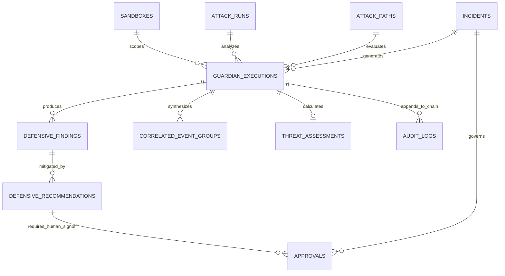

# Blue Guardian Agent — Defensive Relational Database Design
## AegisMesh 2.0 Subsystem Design Specification (Step 09.2.3.1)

---

## 1. Relational Schema Architecture & Design Philosophy

The Blue Guardian database schema extends the AegisMesh 2.0 PostgreSQL persistence layer to capture defensive execution lifecycles, deterministic detection matches, incident correlations, asset blast radiuses, and human-gated remediation recommendations.

### Key Database Design Principles:
1. **Forensic Integrity & Non-Destructive Retention**:
   In alignment with platform security requirements, foreign keys to core security entities (`sandboxes`, `campaigns`, `attack_runs`, `incidents`) use `ON DELETE RESTRICT` to ensure that active or historical defensive forensic records can never be orphaned or silently expunged.
2. **Deterministic Query Performance**:
   Composite B-tree indexes are defined on high-frequency filter paths (e.g., `(sandbox_id, created_at DESC)`, `(guardian_execution_id, severity)`).
3. **Structured Telemetry In JSONB**:
   Unstructured or variable-length evidence sets (e.g., `evidence_event_ids`, `impacted_asset_ids`, `matched_indicators`) leverage PostgreSQL `JSONB` with GIN indexing for fast containment (`@>`) lookups.
4. **Integration with Existing Entities**:
   Directly links to existing `incidents`, `approvals`, `campaigns`, `sandboxes`, and `audit_logs` without breaking backwards compatibility.

---

## 2. Entity Relationship Diagram (ERD)



---

## 3. Table Schema Specifications

### 3.1 Table: `guardian_executions`
Tracks individual defensive intelligence analysis sessions executed against an AttackRun or AttackPath within a sandbox.

```sql
CREATE TABLE guardian_executions (
    id UUID PRIMARY KEY DEFAULT gen_random_uuid(),
    sandbox_id UUID NOT NULL REFERENCES sandboxes(id) ON DELETE RESTRICT,
    attack_run_id UUID REFERENCES attack_runs(id) ON DELETE RESTRICT,
    attack_path_id UUID REFERENCES attack_paths(id) ON DELETE RESTRICT,
    incident_id UUID REFERENCES incidents(id) ON DELETE SET NULL,
    status VARCHAR(32) NOT NULL DEFAULT 'PENDING',
    started_at TIMESTAMPTZ NOT NULL DEFAULT clock_timestamp(),
    completed_at TIMESTAMPTZ,
    events_ingested INTEGER NOT NULL DEFAULT 0 CHECK (events_ingested >= 0),
    detections_matched INTEGER NOT NULL DEFAULT 0 CHECK (detections_matched >= 0),
    findings_generated INTEGER NOT NULL DEFAULT 0 CHECK (findings_generated >= 0),
    risk_score NUMERIC(4, 2) CHECK (risk_score >= 0.0 AND risk_score <= 10.0),
    error_message VARCHAR(2048),
    execution_metadata JSONB NOT NULL DEFAULT '{}'::jsonb,
    created_at TIMESTAMPTZ NOT NULL DEFAULT clock_timestamp(),
    updated_at TIMESTAMPTZ NOT NULL DEFAULT clock_timestamp(),

    CONSTRAINT chk_guardian_execution_target CHECK (
        attack_run_id IS NOT NULL OR attack_path_id IS NOT NULL
    )
);

CREATE INDEX idx_guardian_executions_sandbox_created 
    ON guardian_executions (sandbox_id, created_at DESC);
CREATE INDEX idx_guardian_executions_attack_run 
    ON guardian_executions (attack_run_id);
CREATE INDEX idx_guardian_executions_attack_path 
    ON guardian_executions (attack_path_id);
CREATE INDEX idx_guardian_executions_status 
    ON guardian_executions (status);
```

---

### 3.2 Table: `defensive_findings`
Captures discrete defensive findings identified by the deterministic detection engine.

```sql
CREATE TABLE defensive_findings (
    id UUID PRIMARY KEY DEFAULT gen_random_uuid(),
    guardian_execution_id UUID NOT NULL REFERENCES guardian_executions(id) ON DELETE CASCADE,
    title VARCHAR(256) NOT NULL,
    description TEXT NOT NULL,
    severity VARCHAR(16) NOT NULL CHECK (severity IN ('LOW', 'MEDIUM', 'HIGH', 'CRITICAL')),
    confidence NUMERIC(3, 2) NOT NULL CHECK (confidence >= 0.0 AND confidence <= 1.0),
    rule_ids JSONB NOT NULL DEFAULT '[]'::jsonb,
    evidence_event_ids JSONB NOT NULL DEFAULT '[]'::jsonb,
    asset_ids JSONB NOT NULL DEFAULT '[]'::jsonb,
    mitre_techniques JSONB NOT NULL DEFAULT '[]'::jsonb,
    finding_metadata JSONB NOT NULL DEFAULT '{}'::jsonb,
    created_at TIMESTAMPTZ NOT NULL DEFAULT clock_timestamp()
);

CREATE INDEX idx_defensive_findings_execution 
    ON defensive_findings (guardian_execution_id);
CREATE INDEX idx_defensive_findings_severity 
    ON defensive_findings (severity);
CREATE INDEX idx_defensive_findings_rule_ids_gin 
    ON defensive_findings USING gin (rule_ids);
CREATE INDEX idx_defensive_findings_asset_ids_gin 
    ON defensive_findings USING gin (asset_ids);
```

---

### 3.3 Table: `correlated_event_groups`
Represents synthesized clusters of related events representing lateral movement, multi-stage kill chains, or coordinated threat behaviors.

```sql
CREATE TABLE correlated_event_groups (
    id UUID PRIMARY KEY DEFAULT gen_random_uuid(),
    guardian_execution_id UUID NOT NULL REFERENCES guardian_executions(id) ON DELETE CASCADE,
    sandbox_id UUID NOT NULL REFERENCES sandboxes(id) ON DELETE RESTRICT,
    title VARCHAR(256) NOT NULL,
    stage VARCHAR(32) NOT NULL CHECK (stage IN (
        'RECON', 'INITIAL_ACCESS', 'PRIVILEGE_ESCALATION', 
        'LATERAL_MOVEMENT', 'DATA_EXFILTRATION', 'PERSISTENCE'
    )),
    primary_tactic VARCHAR(64) NOT NULL,
    member_detection_ids JSONB NOT NULL DEFAULT '[]'::jsonb,
    member_event_ids JSONB NOT NULL DEFAULT '[]'::jsonb,
    root_cause_asset_id VARCHAR(128),
    impacted_asset_ids JSONB NOT NULL DEFAULT '[]'::jsonb,
    time_window_start TIMESTAMPTZ NOT NULL,
    time_window_end TIMESTAMPTZ NOT NULL,
    correlation_confidence NUMERIC(3, 2) NOT NULL CHECK (correlation_confidence >= 0.0 AND correlation_confidence <= 1.0),
    created_at TIMESTAMPTZ NOT NULL DEFAULT clock_timestamp()
);

CREATE INDEX idx_correlated_groups_execution 
    ON correlated_event_groups (guardian_execution_id);
CREATE INDEX idx_correlated_groups_sandbox_stage 
    ON correlated_event_groups (sandbox_id, stage);
CREATE INDEX idx_correlated_groups_member_events_gin 
    ON correlated_event_groups USING gin (member_event_ids);
```

---

### 3.4 Table: `threat_assessments`
Maintains quantitative asset blast radiuses, compound risk factors, and risk scores.

```sql
CREATE TABLE threat_assessments (
    id UUID PRIMARY KEY DEFAULT gen_random_uuid(),
    guardian_execution_id UUID NOT NULL UNIQUE REFERENCES guardian_executions(id) ON DELETE CASCADE,
    sandbox_id UUID NOT NULL REFERENCES sandboxes(id) ON DELETE RESTRICT,
    risk_score NUMERIC(4, 2) NOT NULL CHECK (risk_score >= 0.0 AND risk_score <= 10.0),
    severity_factor NUMERIC(3, 2) NOT NULL CHECK (severity_factor >= 0.0 AND severity_factor <= 1.0),
    blast_radius_factor NUMERIC(3, 2) NOT NULL CHECK (blast_radius_factor >= 0.0 AND blast_radius_factor <= 1.0),
    stage_progression_factor NUMERIC(3, 2) NOT NULL CHECK (stage_progression_factor >= 0.0 AND stage_progression_factor <= 1.0),
    confidence_factor NUMERIC(3, 2) NOT NULL CHECK (confidence_factor >= 0.0 AND confidence_factor <= 1.0),
    asset_impact_matrix JSONB NOT NULL DEFAULT '[]'::jsonb,
    assessment_notes TEXT,
    created_at TIMESTAMPTZ NOT NULL DEFAULT clock_timestamp()
);

CREATE INDEX idx_threat_assessments_risk_score 
    ON threat_assessments (risk_score DESC);
CREATE INDEX idx_threat_assessments_sandbox 
    ON threat_assessments (sandbox_id);
```

---

### 3.5 Table: `defensive_recommendations`
Stores human-gated remediation recommendations with explicit safety invariants.

```sql
CREATE TABLE defensive_recommendations (
    id UUID PRIMARY KEY DEFAULT gen_random_uuid(),
    guardian_execution_id UUID NOT NULL REFERENCES guardian_executions(id) ON DELETE CASCADE,
    finding_id UUID NOT NULL REFERENCES defensive_findings(id) ON DELETE RESTRICT,
    category VARCHAR(16) NOT NULL CHECK (category IN ('PATCH', 'CONFIG', 'POLICY', 'ISOLATION')),
    priority INTEGER NOT NULL CHECK (priority BETWEEN 1 AND 5),
    title VARCHAR(256) NOT NULL,
    remediation_guidance TEXT NOT NULL,
    target_component VARCHAR(256) NOT NULL,
    proposed_patch_diff TEXT,
    proposed_policy_rule TEXT,
    automated_remediation_blocked BOOLEAN NOT NULL DEFAULT TRUE CHECK (automated_remediation_blocked = TRUE),
    approval_id UUID REFERENCES approvals(id) ON DELETE SET NULL,
    created_at TIMESTAMPTZ NOT NULL DEFAULT clock_timestamp()
);

CREATE INDEX idx_defensive_recommendations_execution 
    ON defensive_recommendations (guardian_execution_id);
CREATE INDEX idx_defensive_recommendations_finding 
    ON defensive_recommendations (finding_id);
CREATE INDEX idx_defensive_recommendations_priority 
    ON defensive_recommendations (priority ASC);
```

---

## 4. Integration with Existing Platform Models

### 4.1 Relationship with `incidents` Table
The existing `incidents` table in `backend/app/models/incident.py`:
- `id`: UUID Primary Key
- `campaign_id`: UUID Foreign Key (`campaigns.id`, `ON DELETE SET NULL`)
- `title`: String(255)
- `description`: Text
- `severity`: String(50)
- `status`: String(50) (`OPEN`, `INVESTIGATING`, `RESOLVED`, `CLOSED`)
- `source`: String(100) (Populated as `"blue_guardian"`)

**Integration Mechanism**:
When a Blue Guardian execution completes with `risk_score >= 5.0` or findings of severity `HIGH`/`CRITICAL`, the engine synthesizes an `Incident` record with `source = 'blue_guardian'`, linking the `incident_id` back to `guardian_executions.incident_id`.

### 4.2 Relationship with `approvals` Table
The existing `approvals` table in `backend/app/models/approval.py`:
- `id`: UUID Primary Key
- `incident_id`: UUID Foreign Key (`incidents.id`, `ON DELETE CASCADE`)
- `policy_version_id`: UUID Foreign Key
- `requested_by`: UUID Foreign Key (`users.id`)
- `approved_by`: UUID Foreign Key (`users.id`, nullable)
- `status`: String(50) (`PENDING`, `APPROVED`, `REJECTED`)
- `approval_reason`: Text

**Integration Mechanism**:
When an operator chooses to act on a `DefensiveRecommendation`, an `Approval` record is created referencing the associated `incident_id`. The recommendation's `approval_id` is updated. Under no circumstances can a recommendation be enacted without `approvals.status == 'APPROVED'`.

### 4.3 Integration with SHA-256 Chained `audit_logs`
Every significant Blue Guardian lifecycle transition produces a persistent SHA-256 chained audit record via `AuditService.record_event()`:
- `guardian.execution_started`
- `guardian.detections_matched`
- `guardian.threat_assessed`
- `guardian.recommendations_generated`
- `guardian.execution_completed`
- `guardian.remediation_approved`

The cryptographic chain links the `action`, `actor_id`, `details`, and `previous_hash`, ensuring complete tamper evidence for compliance audits.

