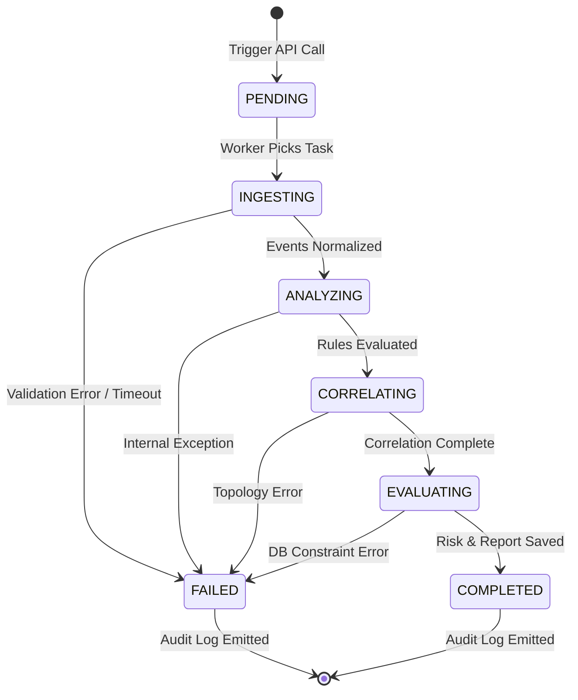

# Blue Guardian Agent — Failure Modes, Recovery Protocols & Idempotency
## AegisMesh 2.0 Subsystem Design Specification (Step 09.2.3.1)

---

## 1. Overview & Resiliency Architecture

In distributed cyber defense simulation platforms, event telemetry may be delayed, duplicated, delivered out of sequence, or truncated due to worker crashes. The **Blue Guardian Agent** is designed to provide high fault tolerance, transactional consistency, and idempotent execution guarantees.

---

## 2. Telemetry Ingestion Failure Modes & Mitigations

### 2.1 Duplicate Event Ingestion
- **Failure Scenario**: Network jitter or Celery task retries cause an `AttackRun` telemetry stream to be submitted to the ingestion pipeline more than once.
- **Protocol**:
  - Ingestion processes events into a temporary in-memory deduplication cache keyed on `(sandbox_id, source_event_id, sha256_hash)`.
  - The PostgreSQL database enforces a unique constraint on `(guardian_execution_id, source_event_id)`:
    ```sql
    CREATE UNIQUE INDEX uq_envelope_exec_source_event 
        ON defensive_findings (guardian_execution_id, ((finding_metadata->>'source_event_id')));
    ```
  - Duplicate events are silently discarded from the evaluation batch, and a metric counter `duplicate_events_skipped` is incremented.

### 2.2 Delayed or Out-of-Order Telemetry
- **Failure Scenario**: Telemetry packets arrive with skewed timestamps or out of chronological order due to asynchronous target agent responses.
- **Protocol**:
  - The normalization phase sorts ingested `DefensiveEventEnvelope` instances chronologically by `timestamp` prior to invoking the rule evaluation pipeline.
  - The correlation engine uses sliding event windows based on event timestamps rather than ingestion arrival times:
    $$t_{\text{start}} = \min_{e \in E}(e.\text{timestamp}), \quad t_{\text{end}} = \max_{e \in E}(e.\text{timestamp})$$
  - Events with timestamps older than the maximum allowable drift ($\Delta t > 24\text{ hours}$) are flagged as `TELEMETRY_EXPIRED` and logged to audit.

### 2.3 Malformed or Missing Evidence Payloads
- **Failure Scenario**: A `SimulationEvent` contains corrupt JSON, missing required fields, or fails Pydantic schema validation.
- **Protocol**:
  - Blue Guardian executes strict Pydantic parsing with `extra="forbid"`.
  - If an individual event fails validation, it is routed to a `dead_letter_events` JSONB array inside `guardian_executions.execution_metadata`.
  - The execution does not fail wholesale; it processes all valid events while recording a warning finding:
    `DEF-WARN-001: Malformed Telemetry Discarded`.

---

## 3. Worker & Process Crash Recovery Protocols

Blue Guardian defensive evaluations run asynchronously via Celery background tasks (`app.workers.guardian_tasks.execute_guardian_analysis`).



### 3.1 Worker Crash / Heartbeat Expiration Recovery
- **Failure Scenario**: The host or worker container crashes mid-analysis while `status = 'ANALYZING'`.
- **Protocol**:
  - A scheduled Celery periodic reaper task (`app.workers.guardian_reaper`) runs every 5 minutes.
  - It identifies executions where `status IN ('INGESTING', 'ANALYZING', 'CORRELATING', 'EVALUATING')` and `updated_at < NOW() - INTERVAL '15 minutes'`.
  - The reaper transitions stale executions to `FAILED` with `error_message = 'EXECUTION_TIMEOUT: Worker heartbeat expired.'` and records an entry to `audit_logs`.

### 3.2 Advisory Locking & Concurrency Control
- **Failure Scenario**: Concurrent API requests attempt to trigger defensive analysis on the same `AttackRun` simultaneously.
- **Protocol**:
  - Blue Guardian acquires a PostgreSQL transaction-scoped advisory lock using a 64-bit integer derived from the target UUID:
    ```python
    lock_id = hash_uuid_to_int64(attack_run_id)
    acquired = await db.execute(
        select(func.pg_try_advisory_xact_lock(lock_id))
    ).scalar_one()
    if not acquired:
        raise ConflictException("A defensive analysis is already in progress for this AttackRun.")
    ```
  - This ensures strict serialization without deadlocking or table-level locks.

---

## 4. Idempotency Guarantees

Every Blue Guardian execution endpoint supports idempotency via an optional `Idempotency-Key` HTTP header.

```
Client Request -> Check Idempotency-Key in Redis (TTL: 24h)
                 |
                 +--> Key Exists & Completed: Return cached 200 OK + payload
                 |
                 +--> Key Exists & In-Progress: Return 409 Conflict / In-Progress
                 |
                 +--> Key Not Found: Acquire lock, proceed with execution, store result
```

- When the same request is replayed with the identical idempotency key, the API immediately returns the existing `GuardianExecution` record.
- Re-running analysis on an immutable `AttackRun` produces identical detection results, risk scores, and findings due to the 100% deterministic rule and risk algorithms.

---

## 5. Transactional Integrity & Rollback Procedures

All database write operations within an execution stage are wrapped in atomic SQLAlchemy async transactions:
1. **Stage 1 Transaction**: Creates `guardian_executions` record with `status = 'INGESTING'`.
2. **Stage 2 Transaction**: Inserts all `defensive_findings` and `correlated_event_groups`.
3. **Stage 3 Transaction**: Inserts `threat_assessments`, `defensive_recommendations`, updates `guardian_executions` to `COMPLETED`, and appends to `audit_logs`.

If an unhandled exception occurs in Stage 2 or 3:
- The transaction rolls back cleanly, leaving no orphaned findings or half-populated correlations.
- An independent error-handling block updates `guardian_executions.status = 'FAILED'`, recording the full traceback in `error_message`.
- An audit entry `guardian.execution_failed` is committed to the SHA-256 audit chain.

