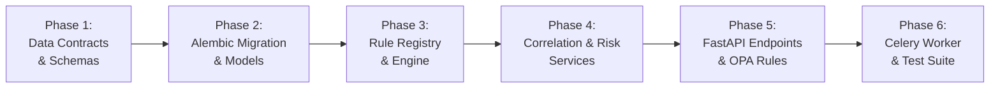

# AegisMesh 2.0 — Step 09.2.3.1 Engineering Design Report
## Blue Guardian Agent: Architecture Design, Threat Intelligence Contracts & Defensive Data Model

---

## 1. Executive Summary & Design Mission

AegisMesh 2.0 has established an autonomous, deterministic offensive capability comprising:
- **Red Team Agent Foundation** (Step 09.1, 09.1.1)
- **Advanced Synthetic Attack Scenario Library** (Step 09.2.1, 8 scenarios)
- **Attack Path Orchestration Engine** (Step 09.2.2, multi-stage DAG attack graphs)

**Step 09.2.3.1** establishes the comprehensive engineering design, threat intelligence data contracts, database schema, API contracts, security invariants, failure recovery protocols, and verification strategy for the platform's defensive counterpart: the **Blue Guardian Agent**.

In accordance with strict architectural requirements for this milestone:
- **Zero runtime code has been modified or implemented prematurely.**
- **Zero Alembic migrations or schema alterations have been applied.**
- **Existing Red Team execution, Attack Path orchestration, and OPA policies remain untouched.**
- **All specifications strictly enforce synthetic-only telemetry, evidence immutability, sandbox boundary containment, and human-in-the-loop remediation barriers.**

---

## 2. Subsystem Architecture & Data Flow

The Blue Guardian Agent operates as a unidirectional, pipelined defensive analysis engine:

```
[AttackRun Metadata / AttackPath Report]
                 │
                 ▼
    ┌───────────────────────────┐
    │  1. Ingestion & Validator │  --> Validates is_simulated=True, verifies SHA-256 digest
    └─────────────┬─────────────┘
                  │ (DefensiveEventEnvelope)
                  ▼
    ┌───────────────────────────┐
    │  2. Rule Detection Engine │  --> Deterministic pattern matching across 8 scenarios
    └─────────────┬─────────────┘
                  │ (DetectionResult)
                  ▼
    ┌───────────────────────────┐
    │  3. Correlation Pipeline  │  --> Scoped temporal windowing (<=300s) & asset graph traversal
    └─────────────┬─────────────┘
                  │ (CorrelatedEventGroup)
                  ▼
    ┌───────────────────────────┐
    │  4. Asset Impact Engine   │  --> Computes direct compromise, blast radius, & critical exposure
    └─────────────┬─────────────┘
                  │ (AssetImpactAssessment)
                  ▼
    ┌───────────────────────────┐
    │  5. Bounded Risk Formula  │  --> Computes deterministic score R in [0.0, 10.0]
    └─────────────┬─────────────┘
                  │ (ThreatAssessment)
                  ▼
    ┌───────────────────────────┐
    │  6. Recommendation Engine │  --> Generates PATCH, CONFIG, POLICY advisories (Safety blocked)
    └─────────────┬─────────────┘
                  │ (DefensiveRecommendation)
                  ▼
    ┌───────────────────────────┐
    │  7. Incident & Audit Log  │  --> Links to platform Incident, appends to SHA-256 audit chain
    └───────────────────────────┘
```

The detailed system architecture specification is documented in [`blue_guardian_architecture.md`](file:///c:/Users/Atharva/OneDrive/Desktop/AEGISMesh/docs/blue_guardian/blue_guardian_architecture.md).

---

## 3. Defensive Intelligence Contracts Specification

Blue Guardian introduces 13 strictly typed Pydantic v2 schemas (`extra="forbid"`, `frozen=True`) classified across four epistemic tiers:

1. **Observed Synthetic Evidence (`OBSERVED`)**:
   - `DefensiveEventEnvelope`: Normalized synthetic event with verified payload SHA-256 hash.
2. **Derived Detection Results (`DERIVED`)**:
   - `DetectionRule`: Deterministic detection rule definition matching MITRE techniques.
   - `DetectionResult`: Discrete outcome produced by matching a rule against an envelope.
   - `DefensiveFinding`: Synthesized defensive finding aggregating detections and assets.
   - `RegressionVerificationResult`: Outcome validating whether a remediation fixes the issue without regression.
3. **Inferred Attack Relationships (`INFERRED`)**:
   - `CorrelatedEventGroup`: Multi-event attack stage sequence with topological mapping.
   - `AssetImpactAssessment`: Blast radius depth and confidentiality/integrity/availability impact.
   - `ThreatAssessment`: Holistic risk rating ($R \in [0.0, 10.0]$) and compound factors.
   - `IncidentReport`: Comprehensive synthesized report with SHA-256 digest.
4. **Defensive Recommendations (`ADVISORY`)**:
   - `DefensiveRecommendation`: Prioritized remediation guidance with `automated_remediation_blocked: Literal[True] = True`.
   - `RemediationApproval`: 4-eyes human governance sign-off record.
   - `GuardianExecution`: Run tracking entity with status enum `GuardianExecutionStatus`.

The complete schema code and field provenance matrix are documented in [`blue_guardian_data_contracts.md`](file:///c:/Users/Atharva/OneDrive/Desktop/AEGISMesh/docs/blue_guardian/blue_guardian_data_contracts.md).

---

## 4. Database Architecture & Schema Extensions

The relational schema design extends the PostgreSQL persistence layer while preserving all existing models:
- **`guardian_executions`**: Tracks defensive analysis runs, linked to `sandboxes`, `attack_runs`, `attack_paths`, and `incidents`.
- **`defensive_findings`**: Stores discrete findings, linked to `guardian_executions` with GIN-indexed JSONB arrays for `rule_ids`, `evidence_event_ids`, and `asset_ids`.
- **`correlated_event_groups`**: Maintains event clusters representing kill-chain phases with `ON DELETE CASCADE` to executions and `ON DELETE RESTRICT` to sandboxes.
- **`threat_assessments`**: Stores bounded risk scores, compound factors, and blast radius matrices.
- **`defensive_recommendations`**: Stores actionable remediation advice linked to `defensive_findings` and `approvals`.

**Forensic Preservation Rule**: Core foreign keys to `sandboxes` and `campaigns` enforce `ON DELETE RESTRICT`, preventing accidental destruction of historical forensic evidence.

The full SQL DDL, indexes, and ERD are documented in [`blue_guardian_database_design.md`](file:///c:/Users/Atharva/OneDrive/Desktop/AEGISMesh/docs/blue_guardian/blue_guardian_database_design.md).

---

## 5. Defensive REST API Specifications

The REST API exposes 9 endpoints under `/api/v1/guardian/*`:
1. `POST /api/v1/guardian/executions` — Trigger defensive analysis.
2. `GET /api/v1/guardian/executions/{id}` — Get execution status and counts.
3. `GET /api/v1/guardian/executions/{id}/detections` — Query raw matched detections.
4. `GET /api/v1/guardian/executions/{id}/findings` — Query synthesized defensive findings.
5. `GET /api/v1/guardian/executions/{id}/correlated-groups` — Query correlated kill-chain stages.
6. `GET /api/v1/guardian/executions/{id}/impact` — Query asset blast radius and risk factors.
7. `GET /api/v1/guardian/executions/{id}/recommendations` — Query human-gated remediation advice.
8. `GET /api/v1/guardian/executions/{id}/report` — Retrieve complete incident report with SHA-256 digest.
9. `POST /api/v1/guardian/approvals` — Submit 4-eyes human approval decision.

All endpoints enforce OPA default-deny authorization, JWT authentication, and RFC 7807 problem details error responses. Full schemas and parameter specifications are documented in [`blue_guardian_api_contracts.md`](file:///c:/Users/Atharva/OneDrive/Desktop/AEGISMesh/docs/blue_guardian/blue_guardian_api_contracts.md).

---

## 6. Security Model, Isolation & Governance Invariants

The security model guarantees strict defense-in-depth:
1. **Synthetic-Only Telemetry**: Defensive engine processes only events marked `is_simulated=True` and `simulation_only=True`. Possesses zero outbound network or shell execution tools.
2. **Evidence Immutability**: Red team telemetry is read-only. Defensive outputs maintain independent cryptographic provenance.
3. **Sandbox Scoping**: Analysis queries are strictly constrained to a single `sandbox_id`. Cross-sandbox queries are rejected.
4. **OPA Default-Deny Policies**: Actions require explicit capabilities (`guardian.analyze` $\rightarrow$ `scan`, `guardian.read` $\rightarrow$ `read`, `guardian.approve_remediation` $\rightarrow$ `admin`).
5. **Human-in-the-Loop Barrier**: Autonomous remediation is strictly prevented by schema invariants (`automated_remediation_blocked: True`) and enforced 4-eyes approval.
6. **Forensic Audit Logging**: All lifecycle milestones append to the persistent SHA-256 cryptographic audit chain.

The comprehensive security specification is documented in [`blue_guardian_security_model.md`](file:///c:/Users/Atharva/OneDrive/Desktop/AEGISMesh/docs/blue_guardian/blue_guardian_security_model.md).

---

## 7. Failure Modes, Idempotency & Recovery Protocols

To guarantee system stability in distributed environments:
- **Deduplication**: Ingestion deduplicates events using an in-memory cache and unique database constraints on `(guardian_execution_id, source_event_id)`.
- **Chronological Reordering**: Out-of-order telemetry is normalized and sorted by event timestamp prior to correlation.
- **Worker Crash Recovery**: Stale or hanging executions are automatically identified by a Celery periodic reaper task and transitioned to `FAILED` with audit logs.
- **Concurrency Control**: Concurrent analysis triggers on the same `AttackRun` are serialized via PostgreSQL advisory transaction locks (`pg_try_advisory_xact_lock`).
- **Transactional Atomicity**: Multi-stage database writes are wrapped in atomic SQLAlchemy transactions with rollback on failure.

Detailed recovery flows are documented in [`blue_guardian_failure_recovery.md`](file:///c:/Users/Atharva/OneDrive/Desktop/AEGISMesh/docs/blue_guardian/blue_guardian_failure_recovery.md).

---

## 8. Comprehensive Verification Strategy

The test strategy establishes a multi-tiered verification plan:
- **Unit Tests**:
  - Schema immutability and `extra="forbid"` validation across all 13 models.
  - Deterministic detection rule matching against all 8 attack scenarios.
  - Mathematical proof of risk score bounds ($0.0 \le R \le 10.0$).
  - Advisory guardrail enforcement (`automated_remediation_blocked == True`).
- **Integration Tests**:
  - End-to-end ingestion and normalization from `AttackRun.execution_metadata`.
  - Correlation pipeline evaluating temporal and graph topologies.
  - PostgreSQL constraints and `ON DELETE RESTRICT` forensic retention.
  - Persistent SHA-256 audit chaining.
- **Security & Authorization Tests**:
  - OPA permission checks across roles and capability scopes.
  - Cross-sandbox telemetry contamination rejection.
  - 4-eyes approval barrier preventing self-approval.

The complete testing matrix and fixture specifications are documented in [`blue_guardian_test_strategy.md`](file:///c:/Users/Atharva/OneDrive/Desktop/AEGISMesh/docs/blue_guardian/blue_guardian_test_strategy.md).

---

## 9. Implementation Roadmap for Step 09.2.3.2

With the architecture, data contracts, database schema, and test strategies fully specified, the platform is ready for implementation in **Step 09.2.3.2**:



- **Phase 1**: Implement Pydantic models in `backend/app/agents/blue_guardian/contracts.py`.
- **Phase 2**: Generate Alembic migration and SQLAlchemy models in `backend/app/models/guardian.py`.
- **Phase 3**: Implement deterministic detection rules in `backend/app/agents/blue_guardian/rules/`.
- **Phase 4**: Implement correlation, impact analysis, and risk scoring in `backend/app/services/guardian/`.
- **Phase 5**: Expose REST endpoints in `backend/app/api/guardian.py` and register OPA policies in `backend/app/authz/guardian.rego`.
- **Phase 6**: Integrate Celery background task in `backend/app/workers/guardian_tasks.py` and run full regression test suite.

