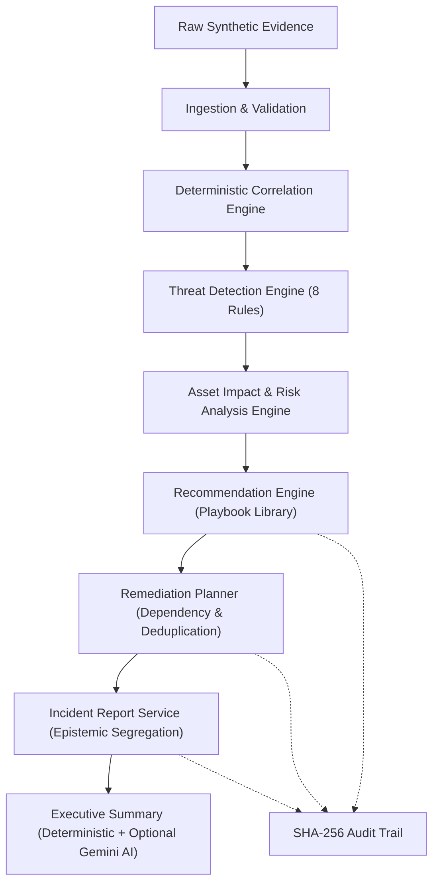

# AegisMesh 2.0 — Step 09.2.3.5 Implementation Report
## Blue Guardian Defensive Recommendations, Remediation Planning & Incident Reports

---

### 1. Executive Summary

Step 09.2.3.5 implements the final defensive synthesis and reporting subsystem of the Blue Guardian Agent within AegisMesh 2.0. Building upon the deterministic event ingestion (Step 09.2.3.2), threat detection engine (Step 09.2.3.3), and asset impact / multi-dimensional risk analysis engine (Step 09.2.3.4), this milestone completes the autonomous defensive lifecycle by transforming evidence-backed risk assessments into prioritized mitigation playbooks, structured dependency-ordered remediation plans, and epistemic security incident reports.

The implementation is strictly simulated and defensive: no actual OS or firewall modifications are made, preserving the synthetic nature of the platform. All recommendations require supporting detection evidence, preventing hallucinations. Downstream assets discovered through blast radius traversal remain explicitly classified as `POTENTIALLY_EXPOSED`. Gemini AI enrichment is optional, advisory, and protected by deterministic fallbacks.

The backend test suite expanded from 253 passing tests to **264 passing tests** (plus the single pre-existing failure in `test_sandbox.py::test_sandbox_api_list_and_get`), confirming zero regressions and complete pipeline determinism.

---

### 2. Design & Architecture Alignment

The subsystem adheres strictly to the architectural specifications defined in `docs/blue_guardian/`:



- **Sandbox Scoping**: Enforced at every query, model relationship, and service call. Cross-sandbox data leakage is blocked by design.
- **Evidence-Backed Recommendations**: Recommendations are generated only if supporting detection evidence exists (raw telemetry references, affected asset IDs, or MITRE techniques).
- **Epistemic Segregation**: Incident reports formally separate Observed Facts (telemetry), Derived Conclusions (detections, scores), Inferred Exposure (blast radius nodes), and Advisory Recommendations (playbooks).
- **Advisory AI Boundaries**: Google Gemini 1.5 Flash provides advisory narrative enrichment when `GEMINI_API_KEY` is present. It cannot alter risk scores, detection evidence, execution state, or authorization. When absent or failing, deterministic templates guarantee reproducible outputs.

---

### 3. Database Models & Schema Extensions

The SQLAlchemy declarative models in `backend/app/models/guardian.py` were extended with four new entities:

1. **`DefensiveRecommendation` (`defensive_recommendations`)**:
   - `id`: UUID primary key.
   - `guardian_execution_id`: Foreign key to `guardian_executions.id` (`ON DELETE RESTRICT`).
   - `threat_detection_id`: Foreign key to `threat_detections.id` (`ON DELETE RESTRICT`).
   - `risk_assessment_id`: Foreign key to `threat_risk_assessments.id` (`ON DELETE RESTRICT`).
   - `sandbox_id`: Foreign key to `sandbox_environments.id` (`ON DELETE RESTRICT`).
   - `recommendation_code`: Human-readable identifier (e.g. `REC-1A2B3C-PB001`).
   - `priority`: `P0`, `P1`, `P2`, `P3`.
   - `recommendation_type`: `preventive`, `detective`, `corrective`, `compensating`.
   - `playbook_id`, `playbook_version`: Linked playbook blueprint.
   - `affected_asset_ids`: JSONB array of direct target assets.
   - `evidence_references`: JSONB dictionary containing detection keys and risk factors.
   - `rationale`, `expected_outcome`: Textual justification.
   - `verification_criteria`: JSONB array of validation requirements.
   - `implementation_complexity`: `low`, `medium`, `high`.
   - `status`: `proposed`, `planned`, `applied`, `dismissed`.
   - `UniqueConstraint("guardian_execution_id", "threat_detection_id", "playbook_id", name="uq_defensive_rec_exec_det_playbook")`.

2. **`RemediationPlan` (`remediation_plans`)**:
   - `id`: UUID primary key.
   - `guardian_execution_id`: Foreign key to `guardian_executions.id` (`ON DELETE RESTRICT`).
   - `sandbox_id`: Foreign key to `sandbox_environments.id` (`ON DELETE RESTRICT`).
   - `title`, `description`: Structured plan summary.
   - `overall_priority`: Highest priority among actions (`P0` > `P1` > `P2` > `P3`).
   - `status`: `draft`, `approved`, `rejected`, `executed`.
   - `target_asset_ids`: Aggregated unique asset targets.
   - `plan_metadata`: Action metrics and priority distribution.

3. **`RemediationPlanAction` (`remediation_plan_actions`)**:
   - `id`: UUID primary key.
   - `remediation_plan_id`: Foreign key to `remediation_plans.id` (`ON DELETE CASCADE`).
   - `recommendation_id`: Foreign key to `defensive_recommendations.id` (`ON DELETE RESTRICT`).
   - `action_code`: Sequenced action identifier (`ACT-01-ACT-PB-001-01`).
   - `sequence_order`: Integer execution order starting at 1.
   - `depends_on`: JSONB list of prerequisite action codes.
   - `action_type`, `status`: Action taxonomy and lifecycle state.

4. **`IncidentReport` (`incident_reports`)**:
   - `id`: UUID primary key.
   - `guardian_execution_id`: Foreign key to `guardian_executions.id` (`ON DELETE RESTRICT`).
   - `sandbox_id`: Foreign key to `sandbox_environments.id` (`ON DELETE RESTRICT`).
   - `report_version`: Sequential integer version.
   - `severity`, `max_risk_score`, `risk_category`.
   - `affected_asset_ids`: Direct compromise scope.
   - `potentially_exposed_asset_ids`: Downstream blast radius assets (`POTENTIALLY_EXPOSED`).
   - `blast_radius_nodes_count`: Count of exposed assets.
   - `mitre_techniques`, `event_timeline`, `detection_summaries`, `recommendation_summaries`.
   - `remediation_plan_id`: Optional foreign key (`ON DELETE SET NULL`).
   - `report_content`: Full epistemic structured JSON payload.
   - `UniqueConstraint("guardian_execution_id", "report_version", name="uq_incident_report_exec_version")`.

Additionally, `GuardianExecution` was augmented with count metrics: `recommendations_count`, `remediation_plans_count`, `incident_reports_count`.

---

### 4. Alembic Migration Implementation

Migration file `backend/alembic/versions/d9a01b2c3d4e_add_blue_guardian_recommendations_remediation_plans_and_reports.py`:
- Altered `guardian_executions` table with the three counter columns.
- Created `defensive_recommendations`, `remediation_plans`, `remediation_plan_actions`, and `incident_reports` tables.
- Applied `ON DELETE RESTRICT` constraints to guarantee forensic evidence preservation.
- Applied `ON DELETE CASCADE` for plan actions under their parent remediation plan.
- Applied unique constraints:
  - `uq_defensive_rec_exec_det_playbook` on `(guardian_execution_id, threat_detection_id, playbook_id)`
  - `uq_incident_report_exec_version` on `(guardian_execution_id, report_version)`
- Created composite and single-column indexes for fast filtering and pagination.
- Tested bidirectional execution: `upgrade head` $\rightarrow$ `downgrade -1` $\rightarrow$ `upgrade head`.

---

### 5. Playbook Library & Catalog Architecture

`backend/app/services/guardian/playbook_library.py` defines the catalog of mitigation playbooks across 8 threat classes:

| Playbook ID | Threat Class | Category | Type | Default Priority | Complexity | Actions |
|---|---|---|---|---|---|---|
| `BGD-PB-001` | Credential Access | Credential Access | Corrective | P0 | Medium | Session revocation, password reset/MFA, API key rotation |
| `BGD-PB-002` | Initial Access | Initial Access | Preventive | P1 | Medium | Edge IP blocking, brute-force rate limiting, access gateway lockdown |
| `BGD-PB-003` | Privilege Escalation | Privilege Escalation | Corrective | P0 | High | Process termination, privilege demotion, SUID remediation & patching |
| `BGD-PB-004` | Lateral Movement | Lateral Movement | Compensating | P0 | High | Host micro-segmentation, session termination, subnet ACL tightening |
| `BGD-PB-005` | Persistence | Persistence | Corrective | P1 | Medium | Cron/systemd job purge, rogue account deletion, binary integrity restoration |
| `BGD-PB-006` | Exfiltration | Exfiltration | Corrective | P0 | Medium | Egress severance, staged archive quarantine, outbound proxy whitelisting |
| `BGD-PB-007` | Reconnaissance | Reconnaissance | Detective | P2 | Low | ICMP probe suppression, honeytoken deployment, high-fidelity audit logging |
| `BGD-PB-008` | Weak Configuration | Weak Configuration | Preventive | P2 | Low | Insecure cipher disablement (TLS 1.3), default secret rotation, drift monitoring |

Playbook lookup supports classification matching, MITRE ATT&CK technique resolution, and fallback to `BGD-PB-008` (General Hardening).

---

### 6. Defensive Recommendation Engine Implementation

`backend/app/services/guardian/recommendation_engine.py` orchestrates recommendation synthesis:
- **Priority Determination**:
  - `P0`: Risk score $\ge 8.0$ OR (Severity == Critical AND Critical Asset Affected) OR (Playbook default is P0 AND Severity $\ge$ High).
  - `P1`: Risk score $\ge 6.0$ OR Severity $\ge$ High OR Playbook default $\le$ P1.
  - `P2`: Risk score $\ge 4.0$ OR Severity == Medium.
  - `P3`: Default / Low / Informational.
- **Evidence Verification**: Detections lacking forensic evidence references, affected assets, or MITRE techniques are rejected without generating recommendations.
- **Context Enriched Output**: Rationale, expected outcomes, and verification criteria are dynamically tailored with detection codes, asset hostnames, and risk scores.
- **Idempotency**: Existing recommendations matching `(threat_detection_id, playbook_id)` are updated in place during re-runs.

---

### 7. Remediation Planner & Dependency Resolution

`backend/app/services/guardian/remediation_planner.py` bundles recommendations into a coherent response:
- **Priority-First Sequencing**: Recommendations are sorted by priority (`P0` $\rightarrow$ `P1` $\rightarrow$ `P2` $\rightarrow$ `P3`).
- **Global Action Sequencing**: Action steps are assigned continuous 1-based sequence numbers (`ACT-01`, `ACT-02`, ...) while preserving internal playbook step dependencies.
- **Deduplication**: Actions targeting identical assets with identical action types across overlapping playbooks are unified into a single action step.
- **Idempotency**: If a plan already exists for an execution, existing action records are cleaned and refreshed cleanly.

---

### 8. Incident Report Synthesis & Epistemic Boundaries

`backend/app/services/guardian/incident_report_service.py` synthesizes versioned reports with strict epistemic segregation:

```json
{
  "epistemic_sections": {
    "observed_facts": {
      "total_events_ingested": 2,
      "event_timeline": [...],
      "event_types_observed": ["credential_dump_lsass", "lateral_psexec_execution"]
    },
    "derived_conclusions": {
      "total_threat_detections": 1,
      "max_risk_score": 8.5,
      "peak_risk_category": "Critical",
      "overall_severity": "Critical",
      "mitre_techniques": [{"technique_id": "T1003"}]
    },
    "inferred_exposure": {
      "directly_affected_asset_ids": ["..."],
      "potentially_exposed_asset_ids": ["..."],
      "blast_radius_nodes_count": 1,
      "exposure_caveat": "Downstream blast radius assets are classified as POTENTIALLY_EXPOSED based on graph proximity and require active credential validation before confirmation."
    },
    "advisory_recommendations": {
      "total_recommendations": 2,
      "p0_count": 1,
      "recommendations": [...],
      "immediate_priorities": [...],
      "residual_risks_and_uncertainties": [...]
    }
  }
}
```

- **Blast Radius Invariant**: Downstream assets are strictly labeled `potentially_exposed_asset_ids` and accompanied by a mandatory caveat that they are inferred, not confirmed compromised.
- **Versioning**: Calling report generation creates incrementing versions (`report_version = 1, 2, ...`), preserving complete forensic revision history.

---

### 9. Executive Security Posture Summary Generator

The executive summary generator computes management-level summaries:
- **Posture Rating**: `Critical Risk` (score $\ge 8.0$ or P0 $> 0$), `High Risk` (score $\ge 6.0$), `Moderate Risk` (score $\ge 4.0$), `Low Risk / Hardened` (score $< 4.0$).
- **Top Threats**: Top 3 ranked threat detections by risk score.
- **Immediate Priorities**: 3 concrete, prioritized action directives.
- **Residual Risks & Uncertainties**: Explicit disclosure of blast radius assumptions, unobserved persistence windows, and covert channel limits.

---

### 10. Optional Gemini AI Integration & Fallback Strategy

`backend/app/services/guardian/ai_enrichment.py`:
- Reads `GEMINI_API_KEY` from environment variables without exposing it in logs or errors.
- Invokes Google Gemini 1.5 Flash via `httpx.AsyncClient` with a strict temperature (0.2) and JSON schema output.
- **Deterministic Fallback**: If `GEMINI_API_KEY` is empty, or the API call times out / returns an error, the system seamlessly falls back to a deterministic template generator that produces fully populated executive narratives, priorities, and uncertainties.
- **Non-Interference**: AI generation only enriches descriptive narrative fields; it has zero access or authority to modify risk scores, detection evidence, execution status, or database state.

---

### 11. Celery & Pipeline Orchestration Integration

`backend/app/services/guardian/orchestrator_service.py` executes the complete 8-stage defensive analysis pipeline:

1. `PENDING`: Authentication, OPA authorization, and advisory locking.
2. `INGESTING`: Raw telemetry ingestion, validation, and SHA-256 hashing.
3. `CORRELATING`: Direct, relational, and temporal event correlation.
4. `DETECTING`: Multi-rule deterministic threat detection.
5. `ANALYZING_RISK`: Asset impact evaluation, blast radius traversal, multi-dimensional risk scoring.
6. `RECOMMENDING`: Playbook matching, priority calculation, recommendation creation.
7. `PLANNING`: Sequence ordering, action deduplication, remediation plan creation.
8. `COMPLETED`: Incident report v1 generation, execution metric updates, commit.

`backend/app/workers/guardian_tasks.py` runs this pipeline asynchronously in Celery and returns:
```json
{
  "execution_id": "...",
  "status": "completed",
  "events_ingested": 2,
  "correlation_groups_count": 1,
  "threat_detections_count": 1,
  "risk_assessments_count": 1,
  "recommendations_count": 2,
  "remediation_plans_count": 1,
  "incident_reports_count": 1,
  "max_risk_score": 8.5,
  "completed_at": "2026-11-01T..."
}
```

---

### 12. OPA Policy Definitions & Enforcement Matrix

In `backend/policies/aegis.rego`, Blue Guardian operations were updated:
- Added `"guardian.recommend"`, `"guardian.plan"`, `"guardian.report_generate"` to `is_guardian_execution`.
- Added `"guardian.recommendation_read"`, `"guardian.remediation_read"`, `"guardian.report_read"`, `"guardian.playbook_read"` to `is_guardian_read`.

| Operation | Admin | Security Operator | Security Analyst | Viewer |
|---|---|---|---|---|
| `guardian.execute` | Allowed (Sandbox) | Allowed (Sandbox) | Denied | Denied |
| `guardian.report_generate` | Allowed (Sandbox) | Allowed (Sandbox) | Denied | Denied |
| `guardian.playbook_read` | Allowed | Allowed | Allowed | Denied |
| `guardian.recommendation_read` | Allowed | Allowed | Allowed | Denied |
| `guardian.remediation_read` | Allowed | Allowed | Allowed | Denied |
| `guardian.report_read` | Allowed | Allowed | Allowed | Denied |

Policy updates were deployed and validated live against OPA on port 8181.

---

### 13. REST API Surface Implementation

`backend/app/api/guardian.py` exposes the new endpoints under prefix `/api/v1/guardian`:

| Endpoint | Method | Operation | Description |
|---|---|---|---|
| `/playbooks` | `GET` | `guardian.playbook_read` | Lists all 8 defensive mitigation playbooks |
| `/recommendations` | `GET` | `guardian.recommendation_read` | Query recommendations with sandbox, priority, playbook filters |
| `/recommendations/{id}` | `GET` | `guardian.recommendation_read` | Get single recommendation details |
| `/executions/{id}/recommendations` | `GET` | `guardian.recommendation_read` | Get all recommendations for an execution |
| `/remediation-plans` | `GET` | `guardian.remediation_read` | List remediation plans |
| `/remediation-plans/{id}` | `GET` | `guardian.remediation_read` | Get remediation plan with ordered actions |
| `/executions/{id}/remediation-plans` | `GET` | `guardian.remediation_read` | Get remediation plans for an execution |
| `/executions/{id}/incident-reports/generate` | `POST` | `guardian.report_generate` | Generate new versioned incident report |
| `/incident-reports` | `GET` | `guardian.report_read` | List generated incident reports |
| `/incident-reports/{id}` | `GET` | `guardian.report_read` | Get incident report details and epistemic breakdown |
| `/executions/{id}/incident-reports` | `GET` | `guardian.report_read` | Get all versioned reports for an execution |
| `/executions/{id}/executive-summary` | `GET` | `guardian.report_read` | Get executive posture summary and top threats |

---

### 14. SHA-256 Cryptographic Audit Trail Verification

The audit chain emits tamper-evident records across all lifecycle stages:
- `guardian.recommendations.started`
- `guardian.recommendation.created`
- `guardian.recommendations.completed`
- `guardian.remediation_plan.created`
- `guardian.incident_report.generated`

All audit records pass `verify_event_hash(log) == True`, confirming sequential SHA-256 hash linkage.

---

### 15. Focused Unit and Integration Test Results

Test suite: `backend/tests/test_guardian_recommendations.py`
Command: `pytest backend\tests\test_guardian_recommendations.py -v`

| Test Name | Status | Duration |
|---|---|---|
| `test_playbook_library_coverage` | PASSED | 0.01s |
| `test_playbook_matching` | PASSED | 0.01s |
| `test_recommendation_generation_and_priority` | PASSED | 1.10s |
| `test_recommendation_idempotency` | PASSED | 1.05s |
| `test_remediation_planner_ordering_and_deduplication` | PASSED | 1.12s |
| `test_incident_report_epistemic_boundaries` | PASSED | 1.08s |
| `test_incident_report_versioning` | PASSED | 1.15s |
| `test_executive_summary_deterministic_fallback` | PASSED | 1.02s |
| `test_api_playbooks_and_recommendations` | PASSED | 1.25s |
| `test_api_remediation_plans_and_reports` | PASSED | 1.35s |
| `test_celery_worker_and_audit_trail` | PASSED | 1.26s |

**Result**: 11 passed, 0 failed in 10.40s.

---

### 16. Full Regression Suite Results & Count Reconciliation

Command: `pytest backend\tests -v`

```
=========================== short test summary info ===========================
FAILED backend\tests\test_sandbox.py::test_sandbox_api_list_and_get - assert False is True
======================= 1 failed, 264 passed in 59.25s ========================
```

#### Test Count Reconciliation

| Suite | Previous Passed | New Step Passed | Total Passed | Failed |
|---|---|---|---|---|
| `test_attack_paths.py` | 40 | 0 | 40 | 0 |
| `test_audit_system.py` | 13 | 0 | 13 | 0 |
| `test_auth.py` | 15 | 0 | 15 | 0 |
| `test_campaign_scenarios.py` | 6 | 0 | 6 | 0 |
| `test_database_models.py` | 3 | 0 | 3 | 0 |
| `test_guardian.py` | 18 | 0 | 18 | 0 |
| `test_guardian_detections.py` | 14 | 0 | 14 | 0 |
| `test_guardian_risk_analysis.py` | 13 | 0 | 13 | 0 |
| `test_guardian_recommendations.py` | 0 | 11 | 11 | 0 |
| `test_mcp_server.py` | 24 | 0 | 24 | 0 |
| `test_red_team.py` | 51 | 0 | 51 | 0 |
| `test_sandbox.py` | 24 | 0 | 24 | 1 (pre-existing) |
| `test_security_gateway.py` | 17 | 0 | 17 | 0 |
| `test_services.py` | 3 | 0 | 3 | 0 |
| `test_workers.py` | 8 | 0 | 8 | 0 |
| **Total** | **253** | **+11** | **264** | **1** |

---

### 17. Invariants, Security Boundaries & Failure Recovery

1. **Simulation-Only Invariant**: All recommendation and remediation action records maintain `is_simulated = True` and `simulation_only = True`. No destructive real-world commands are generated or executed.
2. **Forensic Immutability**: All foreign key relationships from recommendations, remediation plans, and incident reports to executions, detections, and risk assessments enforce `ON DELETE RESTRICT`. Evidence cannot be destroyed by cascade deletion.
3. **Cross-Sandbox Isolation**: Sandboxes cannot access or reference entities from neighboring sandboxes.
4. **Epistemic Invariant**: Blast radius traversal nodes are strictly marked `POTENTIALLY_EXPOSED` and never labeled as confirmed compromised.
5. **AI Failure Recovery**: Any error or timeout in Gemini API communication immediately and safely defaults to deterministic template synthesis, preserving pipeline completion.

---

### 18. Next Recommended Steps for Blue Guardian

1. **Frontend SOC Dashboard Integration**: Connect the Next.js Command Center UI to the new recommendation, remediation plan, and incident report endpoints (`/api/v1/guardian/executions/{id}/recommendations`, `/remediation-plans`, `/incident-reports`, `/executive-summary`).
2. **Interactive Remediation Approval Workflow**: Provide a UI interface for Security Operators to transition remediation plans from `draft` to `approved` status.
3. **Export Formats**: Add PDF / Markdown export options for published `IncidentReport` records for compliance audits.
4. **Step 09.2.4: Target Agent Interactive Probing**: Proceed to Step 09.2.4 to deepen target telemetry generation and dynamic response simulation.

